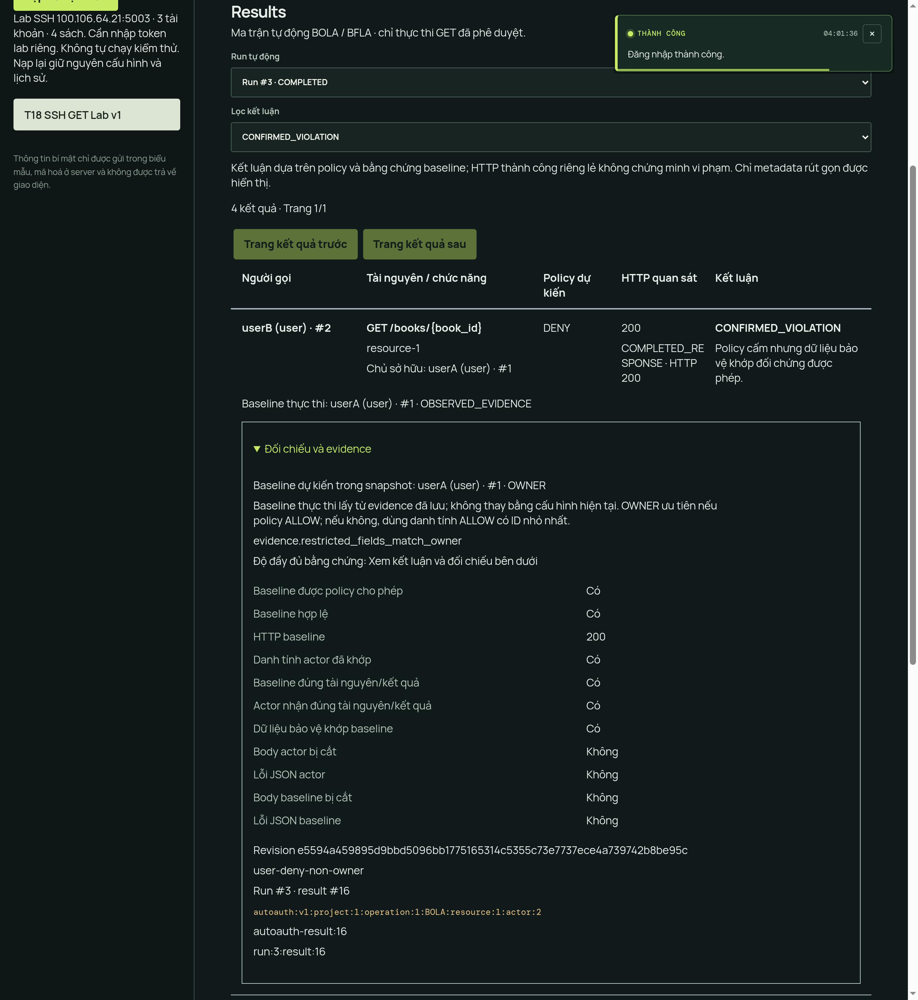
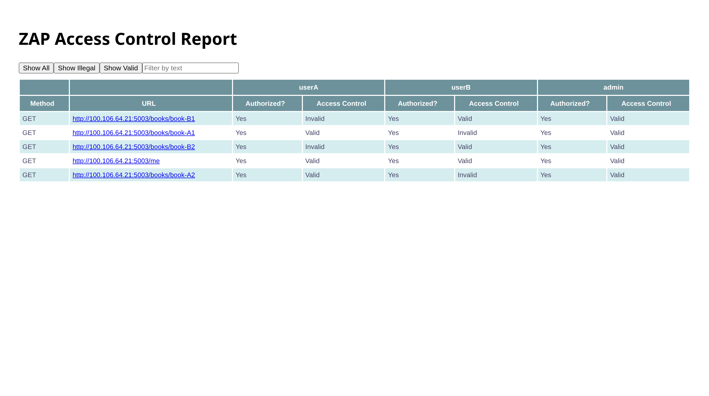
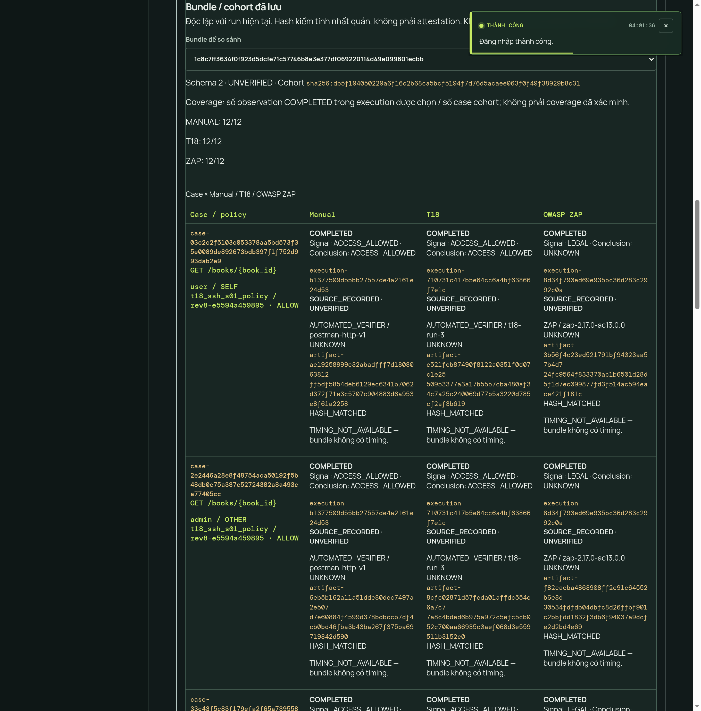
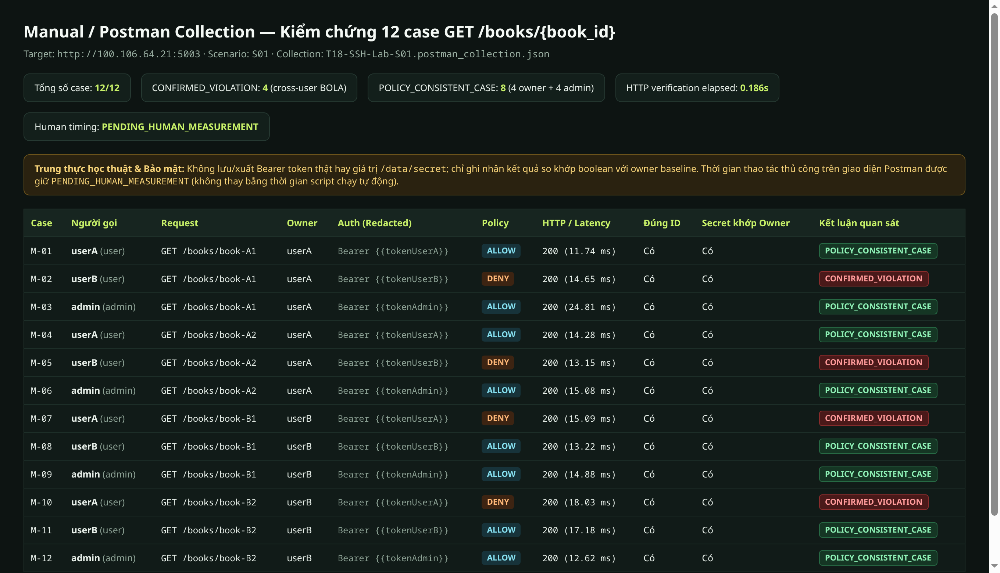

# Báo cáo thực nghiệm đối chiếu: T18 vs. OWASP ZAP vs. Manual (Postman)

- **Ngày thực nghiệm:** 26/11/2026
- **Dự án Web Control Room:** `T18 SSH GET Lab v1` (`http://127.0.0.1:8000`)
- **API đích (SSH Lab):** `http://100.106.64.21:5003` (Scenario `S01` — `GET /books/{book_id}`)
- **Policy Revision:** Revision #8 (`e5594a459895d9bbd5096bb1775165314c5355c73e7737ece4a739742b8be95c`)
- **Comparison Bundle đã nạp trên Web:** Schema 2 · `content_digest`: `1c8c7ff3634f0f923d5dcfe71c57746b8e3e377df069220114d49e099801ecbb` · `attestation_status`: `UNVERIFIED`
- **Nguyên tắc bảo mật:** Không lưu, không in và không xuất Bearer token hay giá trị `/data/secret` thô trong bất kỳ artifact, JSON hay ảnh minh chứng nào (`credential_or_secret_values_exported = false`).

---

## 1. Tóm tắt điều hành (Executive Summary)

Cả ba phương pháp (**T18 Web Control Room**, **OWASP ZAP 2.17.0 / Access Control 13.0.0**, và **Manual / Postman Collection**) đã được thực thi trên **cùng một cohort 12 case `GET /books/{book_id}`** (4 sách `book-A1`, `book-A2`, `book-B1`, `book-B2` × 3 tài khoản `userA`, `userB`, `admin`), cùng thời điểm với bộ token hợp lệ mới cấp, cùng policy Revision #8 (`ssh-owner`, `user-deny-non-owner`, `admin-read-all-books`).

| Tiêu chí | T18 (`Run #3`) | OWASP ZAP (`2.17.0` / `AC 13.0.0`) | Manual / Postman (`T18-SSH-Lab-S01`) |
|---|---|---|---|
| **Số case thực thi / Cohort** | **12 / 12** (19 requests: 3 xác minh + 4 baseline + 12 case) | **12 / 12** (+ `/me` đối chứng xác thực) | **12 / 12** (+ 4 baseline owner) |
| **Vi phạm BOLA phát hiện** | **4 `CONFIRMED_VIOLATION`** | **4 `ILLEGAL`** (`Invalid`) | **4 `CONFIRMED_VIOLATION`** *(quan sát trực tiếp)* |
| **Ca hợp lệ (Owner + Admin)** | **8 `POLICY_CONSISTENT_CASE`** | **8 `VALID`** (`Valid`) | **8 `POLICY_CONSISTENT_CASE`** |
| **Lỗi transport / chặn scope** | `0` errors · `0` scope blocked | `0` lỗi ngoài allowlist | `0` errors |
| **Thời gian thực thi tự động** | **`1.445s`** (queue → `COMPLETED`) | **`1.274s`** *(riêng bước Access Control scan, chưa tính thời gian khởi động JVM & cấu hình Context)* | `0.186s` *(kiểm chứng HTTP tự động)* / **`PENDING_HUMAN_MEASUREMENT`** *(thời gian bấm tay trên Postman)* |
| **Chiều sâu bằng chứng** | **11 cờ evidence** + đối chiếu chính xác `/data/secret` với baseline owner (`OBSERVED_EVIDENCE`) | Chỉ đối chiếu rule Access Control + `loggedInIndicator` / phản hồi HTTP; **không** đối chiếu giá trị trường bảo vệ với baseline owner | Người kiểm thử đọc trực tiếp JSON từng request; tốn công sức thủ công nếu mở rộng số role/resource |
| **Artifact truy vết** | `run:3:result:15`..`26`, `autoauth-result:16,19,21,24` | `results/cohort-ssh-s01/zap_access_control_summary.json` | `results/cohort-ssh-s01/T18-SSH-Lab-S01.postman_collection.json` |

---

## 2. Bảng đối chiếu chi tiết 12/12 case

> [!NOTE]
> Cột **`Ground Truth (Chờ duyệt)`** để trống trạng thái phê duyệt con người (`PENDING_REVIEW`) theo đúng nguyên tắc nghiên cứu của dự án. Chỉ sau khi người vận hành/giảng viên xác nhận cột này mới được công bố các chỉ số `TP / FP / TN / FN`, `Precision`, `Recall` và `Accuracy`.

| # | Người gọi (`Vai trò`) | Tài nguyên (`Owner`) | Policy Rev #8 | T18 (`Run #3`) | OWASP ZAP (`AC 13.0.0`) | Manual / Postman | Truy vết T18 (`artifact_ref` / `finding_id`) | Ground Truth |
|---|---|---|---|---|---|---|---|---|
| 1 | `userA` (`user`) | `book-A1` / `resource-1` (`userA`) | `ALLOW` (`ssh-owner`) | `HTTP 200` · `POLICY_CONSISTENT_CASE` | `Valid` (`LEGAL`) | `HTTP 200` · `POLICY_CONSISTENT_CASE` | `run:3:result:15` · — | `PENDING_REVIEW` |
| 2 | `userB` (`user`) | `book-A1` / `resource-1` (`userA`) | `DENY` (`user-deny-non-owner`) | `HTTP 200` · **`CONFIRMED_VIOLATION`** | **`Invalid` (`ILLEGAL`)** | `HTTP 200` · **`CONFIRMED_VIOLATION`** | `run:3:result:16` · `autoauth-result:16` | `PENDING_REVIEW` |
| 3 | `admin` (`admin`) | `book-A1` / `resource-1` (`userA`) | `ALLOW` (`admin-read-all-books`) | `HTTP 200` · `POLICY_CONSISTENT_CASE` | `Valid` (`LEGAL`) | `HTTP 200` · `POLICY_CONSISTENT_CASE` | `run:3:result:17` · — | `PENDING_REVIEW` |
| 4 | `userA` (`user`) | `book-A2` / `resource-2` (`userA`) | `ALLOW` (`ssh-owner`) | `HTTP 200` · `POLICY_CONSISTENT_CASE` | `Valid` (`LEGAL`) | `HTTP 200` · `POLICY_CONSISTENT_CASE` | `run:3:result:18` · — | `PENDING_REVIEW` |
| 5 | `userB` (`user`) | `book-A2` / `resource-2` (`userA`) | `DENY` (`user-deny-non-owner`) | `HTTP 200` · **`CONFIRMED_VIOLATION`** | **`Invalid` (`ILLEGAL`)** | `HTTP 200` · **`CONFIRMED_VIOLATION`** | `run:3:result:19` · `autoauth-result:19` | `PENDING_REVIEW` |
| 6 | `admin` (`admin`) | `book-A2` / `resource-2` (`userA`) | `ALLOW` (`admin-read-all-books`) | `HTTP 200` · `POLICY_CONSISTENT_CASE` | `Valid` (`LEGAL`) | `HTTP 200` · `POLICY_CONSISTENT_CASE` | `run:3:result:20` · — | `PENDING_REVIEW` |
| 7 | `userA` (`user`) | `book-B1` / `resource-3` (`userB`) | `DENY` (`user-deny-non-owner`) | `HTTP 200` · **`CONFIRMED_VIOLATION`** | **`Invalid` (`ILLEGAL`)** | `HTTP 200` · **`CONFIRMED_VIOLATION`** | `run:3:result:21` · `autoauth-result:21` | `PENDING_REVIEW` |
| 8 | `userB` (`user`) | `book-B1` / `resource-3` (`userB`) | `ALLOW` (`ssh-owner`) | `HTTP 200` · `POLICY_CONSISTENT_CASE` | `Valid` (`LEGAL`) | `HTTP 200` · `POLICY_CONSISTENT_CASE` | `run:3:result:22` · — | `PENDING_REVIEW` |
| 9 | `admin` (`admin`) | `book-B1` / `resource-3` (`userB`) | `ALLOW` (`admin-read-all-books`) | `HTTP 200` · `POLICY_CONSISTENT_CASE` | `Valid` (`LEGAL`) | `HTTP 200` · `POLICY_CONSISTENT_CASE` | `run:3:result:23` · — | `PENDING_REVIEW` |
| 10 | `userA` (`user`) | `book-B2` / `resource-4` (`userB`) | `DENY` (`user-deny-non-owner`) | `HTTP 200` · **`CONFIRMED_VIOLATION`** | **`Invalid` (`ILLEGAL`)** | `HTTP 200` · **`CONFIRMED_VIOLATION`** | `run:3:result:24` · `autoauth-result:24` | `PENDING_REVIEW` |
| 11 | `userB` (`user`) | `book-B2` / `resource-4` (`userB`) | `ALLOW` (`ssh-owner`) | `HTTP 200` · `POLICY_CONSISTENT_CASE` | `Valid` (`LEGAL`) | `HTTP 200` · `POLICY_CONSISTENT_CASE` | `run:3:result:25` · — | `PENDING_REVIEW` |
| 12 | `admin` (`admin`) | `book-B2` / `resource-4` (`userB`) | `ALLOW` (`admin-read-all-books`) | `HTTP 200` · `POLICY_CONSISTENT_CASE` | `Valid` (`LEGAL`) | `HTTP 200` · `POLICY_CONSISTENT_CASE` | `run:3:result:26` · — | `PENDING_REVIEW` |

---

## 3. Hình ảnh minh chứng (đã kiểm duyệt, không lộ token/secret)

### 3.1. T18 Web Control Room — `Run #3` (`Results` & 11 cờ `Đối chiếu và evidence`)

### 3.2. OWASP ZAP 2.17.0 — Báo cáo `Access Control 13.0.0`

### 3.3. Đối chiếu 3 phương pháp ngay trong Web Control Room (`Bundle / cohort đã lưu`)

Comparison Bundle Schema 2 (`digest: 1c8c7ff3634f0f923d5dcfe71c57746b8e3e377df069220114d49e099801ecbb`) đã được nạp thành công vào dự án **`T18 SSH GET Lab v1`** (`MANUAL: 12/12`, `T18: 12/12`, `ZAP: 12/12`, toàn bộ 36 receipt `HASH_MATCHED`, `SOURCE_RECORDED · UNVERIFIED`):

### 3.4. Manual / Postman Collection — Bảng kiểm chứng 12 request

File Postman Collection (`results/cohort-ssh-s01/T18-SSH-Lab-S01.postman_collection.json`) và Environment template (`results/cohort-ssh-s01/T18-SSH-Lab-S01.postman_environment.template.json`) đã được xuất sẵn không chứa token thật (dùng `{{tokenUserA}}`, `{{tokenUserB}}`, `{{tokenAdmin}}`) để bạn có thể nhập trực tiếp vào Postman và bấm giờ thủ công bổ sung khi cần:

---

## 4. Nhận xét chuyên môn & Phụ lục TC-05

### 4.1. So sánh năng lực thực tế giữa 3 phương pháp

1. **Độ tương đồng phát hiện trên Scenario `S01`:** Cả 3 phương pháp đều xác định chính xác **4 ca BOLA truy cập chéo** (`userB → book-A1, book-A2`; `userA → book-B1, book-B2`) và **8 ca hợp lệ** (4 owner + 4 admin).
2. **Khác biệt cốt lõi về bằng chứng giữa T18 và OWASP ZAP:**
   - **T18** không kết luận dựa vào mã HTTP `200` đơn lẻ; công cụ tự động lấy đối chứng từ chủ sở hữu (`owner baseline`), kiểm tra đúng `resource_id` (`/data/id`) và **so khớp chính xác trường dữ liệu bảo vệ (`/data/secret`)** kèm 11 cờ kiểm chứng (`evidence.restricted_fields_match_owner`).
   - **OWASP ZAP Access Control** đánh giá dựa trên cây URL + quy tắc `ALLOWED`/`DENIED` khai báo trong Context XML và `loggedInIndicator`; do đó kết luận `ILLEGAL` của ZAP **không tự chứng minh** phản hồi thực sự rò rỉ dữ liệu bảo vệ của owner (dễ gặp dương tính giả trên các API trả HTTP `200` kèm thông báo từ chối hoặc trả sai tài nguyên). Ngoài ra, ZAP đòi hỏi cấu hình Context XML, script xác thực Bearer token và seed URL thủ công phức tạp hơn đáng kể so với Web Control Room của T18.
3. **Vai trò của Manual (Postman):** Độ linh hoạt cao và kiểm chứng trực quan, nhưng thời gian thao tác tỷ lệ thuận với tích `số tài khoản × số tài nguyên × số endpoint` và dễ sai sót khi đối chiếu thủ công nhiều trường dữ liệu.

### 4.2. Phụ lục kiểm chứng TC-05 (An toàn, Fail-Closed & Lịch sử bất biến)

Trong cùng chuỗi thực nghiệm trước khi chạy `Run #3`, các kiểm chứng an toàn của **TC-05** đã hoàn tất:
- **Khóa method non-GET:** nhập `DELETE /books/{book_id}` → Matrix khóa cứng checkbox ở trạng thái `NOT_RUN` (`DISPOSABLE_WRITE_AUTHORIZATION_REQUIRED`), sau đó bỏ chọn (`selected = 0`).
- **Lịch sử bất biến:** `Run #1` (`Revision #6`, `7e406e20…`, 12 cases / 19 requests) giữ nguyên toàn vẹn sau khi tạo `Revision #7` và `Revision #8` (`e5594a45…`).
- **Chạy chọn lọc & cơ chế Fail-Closed khi token hết hạn (`Run #2`):** `Run #2` chạy 2 case chọn lọc (`5 requests`) vào thời điểm token SSH lab cũ đã hết hạn (`HTTP 401`) → công cụ lập tức đánh nhãn **`INVALID_TEST`** (`evidence.principal_mismatch`), tuyệt đối không kết luận nhầm là `POLICY_CONSISTENT_CASE` hay `CONFIRMED_VIOLATION`.

### 4.3. Ranh giới kết luận (Tránh overclaiming)

- Cohort hiện tại gồm **3 tài khoản / 2 role** (`user`, `admin`) trên 1 endpoint `GET /books/{book_id}` — **chưa đạt gate 3–5 role** (TC-02), chưa bao phủ **denial convention / 403** (TC-03), **GET BFLA** (TC-04) và **Write-BFLA** (TC-06).
- Thời gian thao tác thủ công trên giao diện Postman được giữ trung thực là **`PENDING_HUMAN_MEASUREMENT`**; không lấy thời gian kiểm chứng HTTP tự động (`0.186s`) thay cho thời gian đo bằng tay của con người.
- Toàn bộ artifact trong bundle có `attestation_status = UNVERIFIED` (`HASH_MATCHED` chỉ xác nhận toàn vẹn byte, không thay cho chứng thực của con người). Chỉ tính và công bố `TP/FP/TN/FN`, `Precision`, `Recall` sau khi người đánh giá duyệt xong cột `Ground Truth`.
