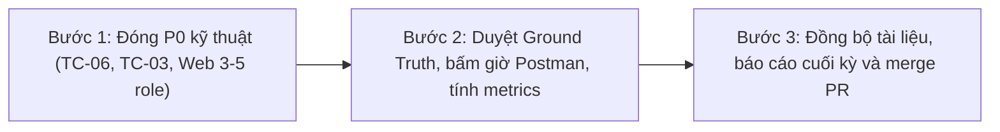

# Báo cáo Tiến độ Dự án T18: Phần Đã Làm & Kế Hoạch Hoàn Thiện

- **Dự án:** Nghiên cứu và phát hiện lỗi phân quyền REST API (IDOR/BOLA, BFLA, Excessive Data Exposure, Write-BOLA)
- **Ngày lập báo cáo:** 27/11/2026
- **Trạng thái Git:** Nhánh `docs/zap-authz-completion` tại commit `0b0a700` *(đã đồng bộ lên `origin`)*
- **Trạng thái nghiệm thu tổng thể:** **`PARTIAL`** *(phần mềm, cơ chế an toàn, bộ kiểm thử tự động, tài liệu vận hành và các thực nghiệm chính đã triển khai; còn một số hạng mục thực nghiệm mở rộng, duyệt Ground Truth, đo thời gian thủ công và tổng hợp báo cáo cuối kỳ để đạt mức hoàn thiện đầy đủ R1–R8)*

---

## Mục lục

- [1. Tổng quan trạng thái dự án](#1-tổng-quan-trạng-thái-dự-án)
- [2. Những phần ĐÃ LÀM (kèm bằng chứng xác minh)](#2-những-phần-đã-làm-kèm-bằng-chứng-xác-minh)
  - [2.1. Hệ thống phần mềm & kiến trúc an toàn](#21-hệ-thống-phần-mềm--kiến-trúc-an-toàn)
  - [2.2. Kết quả kiểm thử tự động & QA độc lập](#22-kết-quả-kiểm-thử-tự-động--qa-độc-lập)
  - [2.3. Các đợt thực nghiệm đã hoàn thành](#23-các-đợt-thực-nghiệm-đã-hoàn-thành)
  - [2.4. Tài liệu, minh chứng và quản lý mã nguồn](#24-tài-liệu-minh-chứng-và-quản-lý-mã-nguồn)
- [3. Đối chiếu hiện trạng theo 8 yêu cầu nghiệm thu (R1–R8)](#3-đối-chiếu-hiện-trạng-theo-8-yêu-cầu-nghiệm-thu-r1r8)
- [4. Những phần CẦN LÀM để hoàn thiện (theo mức ưu tiên)](#4-những-phần-cần-làm-để-hoàn-thiện-theo-mức-ưu-tiên)
  - [4.1. Ưu tiên P0 — Thực nghiệm, Ground Truth và xử lý lỗi còn mở](#41-ưu-tiên-p0--thực-nghiệm-ground-truth-và-xử-lý-lỗi-còn-mở)
  - [4.2. Ưu tiên P1 — Đồng bộ tài liệu và hoàn thiện báo cáo cuối kỳ](#42-ưu-tiên-p1--đồng-bộ-tài-liệu-và-hoàn-thiện-báo-cáo-cuối-kỳ)
  - [4.3. Ưu tiên P2 — Hoàn thiện bàn giao Git & chuẩn bị bảo vệ/demo](#43-ưu-tiên-p2--hoàn-thiện-bàn-giao-git--chuẩn-bị-bảo-vệdemo)
- [5. Lộ trình thực hiện khuyến nghị](#5-lộ-trình-thực-hiện-khuyến-nghị)

---

## 1. Tổng quan trạng thái dự án

Dự án hiện được chia thành **hai thành phần tách biệt về ranh giới an toàn**:

1. **Web Control Room (`backend/` + `frontend/` + `deploy/`):** Ứng dụng FastAPI/React + SQLite chạy ở `http://127.0.0.1:8000`, chỉ thực thi các kiểm thử **GET read-only** đã được phê duyệt, quản lý quy trình 5 tab (`Setup` → `Matrix` → `Run` → `Results` → `Comparison`), đối chiếu bằng chứng qua 11 cờ evidence và nạp Comparison Bundle Schema 2.
2. **Bộ công cụ CLI nghiên cứu (`tools/authorization-lab/`):** Package `authz_lab` độc lập (không bị web import hay gọi `subprocess`), phục vụ kiểm thử đa vai trò VAmPI (`vampi-authz-lab`), đánh giá đối chứng (`vampi-authz-evaluate`), bridge read-only qua Unix socket (`vampi-authz-lab-bridge`) và kiểm thử destructive có kiểm soát trên disposable lab (`vampi-bfla-disposable`).

| Trụ cột công việc | Tiến độ | Tóm tắt ngắn |
|---|---|---|
| Kiến trúc & mã nguồn Web + CLI | **Hoàn thiện** | Đủ luồng AutoAuth v3, che secret/token, xem ID có kiểm soát, Comparison Schema 2, bridge & disposable guardrails |
| Bộ kiểm thử tự động (Unit/Integration/UI) | **Đạt 100%** | `248` backend tests, `367` lab tests (`531` subtests), `71` frontend tests + lint/build PASS |
| Thực nghiệm GET BOLA & đối chiếu 3 phương pháp (SSH Lab) | **Đã chạy (chờ duyệt GT & đo tay)** | `Run #1`, `Run #2`, `Run #3` + OWASP ZAP 2.17.0 + Postman Collection + nạp Bundle Schema 2 lên Web |
| Thực nghiệm 5-role VAmPI (CLI) & Synthetic GET BFLA (Web) | **Đã chạy một phần** | CLI chạy xong 5 roles / 46 cases (`tc02-tc04-vampi-5roles`); Web chạy `Run #4` (synthetic GET BOLA + BFLA) |
| Thực nghiệm Disposable Write-BFLA (TC-06) | **Đạt một phần (còn lỗi)** | Luồng chuẩn (`bfla20261127a`) đạt `DENIED_CONTROL`, nhưng `execute-extended` (`bfla20261127c`) bị `STAGE_FAILED` và teardown là `TEARDOWN_INCOMPLETE` |
| Thực nghiệm Denial Convention / 403 (TC-03) & Web 3–5 role | **Chưa chạy** | Web SSH lab mới có 2 role (`user`, `admin`); chưa chạy case chặn đúng với `denial_pointer/denial_value` |
| Tài liệu vận hành & đối chiếu | **Đã có bản đầy đủ, cần đồng bộ mới** | Đã có `docs/huong-dan-chay-du-an.vi.md` và `docs/bao-cao-doi-chieu-t18-zap-manual.vi.md`; cần đồng bộ thêm kết quả mới ngày 27/11 và hoàn thiện báo cáo cuối kỳ `.docx` |

---

## 2. Những phần ĐÃ LÀM (kèm bằng chứng xác minh)

### 2.1. Hệ thống phần mềm & kiến trúc an toàn

- **Web Control Room (`backend/app/`, `frontend/src/`):**
  - Hoàn thiện luồng 5 bước: `Setup` (5 trạm cấu hình) → `Matrix` (xem trước ma trận, lọc 5 chiều, khóa chọn tự động theo 7 mã lý do, hiển thị `Identity exclusions` & cảnh báo mapping) → `Run` (tính ngân sách request, đóng băng snapshot lúc queue, theo dõi/hủy run) → `Results` (6 kết luận public, bộ lọc kết luận, phân trang, khối `Đối chiếu và evidence` 11 cờ) → `Comparison` (bảng đối chiếu + khối `Lịch sử và bundle so sánh đã lưu`).
  - **Mô hình policy AutoAuth v3:** Quy tắc kết hợp `AND`, ưu tiên `DENY > UNKNOWN > ALLOW` (mặc định `UNKNOWN`), lưu revision SHA-256 append-only (trả HTTP `409` nếu quay lại digest cũ), đóng băng toàn bộ snapshot lúc queue giúp kết quả lịch sử bất biến.
  - **Cơ chế bảo vệ dữ liệu nhạy cảm & an toàn transport:**
    - Bearer token write-only, mã hóa Fernet phía server + HMAC-SHA256 fingerprint; không trả về API/UI/log.
    - Không lưu và không hiển thị response body hay giá trị `/data/secret` thô; chỉ lưu allowlist 11 cờ đối chiếu và metadata rút gọn.
    - Cơ chế **`Xem ID đã lưu`** (`POST .../resources/{id}/inspect`) yêu cầu admin + CSRF + `no-store`, tự ẩn khi rời tab (`visibilitychange`), kèm `Request preview` không gửi HTTP ra lab.
    - Transport khóa cứng GET-only, chặn redirect, tắt cookie/env proxy, chặn vĩnh viễn `/createdb`, allowlist IP/CIDR/port/path.
  - **Nạp dữ liệu mẫu & Comparison Bundle:**
    - Nút `Nạp dữ liệu mẫu` (`POST /api/demo/ssh-seed`) khởi tạo `T18 SSH GET Lab v1` không tạo token giả, không tự chạy kiểm thử, nạp lại giữ nguyên cấu hình & lịch sử.
    - Hỗ trợ nhập và xác thực **Comparison Bundle Schema 2** (kiểm tra `CaseManifest`, `Provenance`, receipt SHA-256 `HASH_MATCHED`, tách biệt nguồn legacy `UNLINKED`, giữ `attestation_status = UNVERIFIED`).
- **Công cụ CLI nghiên cứu (`tools/authorization-lab/`):**
  - 4 entry points tách biệt: `vampi-authz-lab`, `vampi-authz-lab-bridge` (Unix socket, tắt mặc định), `vampi-authz-evaluate`, `vampi-bfla-disposable` (kèm Compose riêng `deploy/labs/vampi-bfla-disposable.compose.yaml` bind `127.0.0.1:5003`).
  - Hỗ trợ bootstrap Controlled BOLA Lab qua `tools/run_controlled_bola_bootstrap.sh`.

### 2.2. Kết quả kiểm thử tự động & QA độc lập

Đã chạy và xác nhận đạt 100% trước khi push commit `0b0a700`:

| Bộ kiểm thử | Lệnh chạy | Kết quả |
|---|---|---|
| Web Backend | `python -m pytest backend/tests -q` | **248 passed** |
| Authorization-lab CLI | `PYTHONPATH=tools/authorization-lab/src python -m pytest tools/authorization-lab/tests -q` | **367 passed, 531 subtests passed** |
| Web Frontend | `cd frontend && npm run lint && npm run test && npm run build` | **9 files, 71 tests passed**; lint & build đạt |

Ngoài ra, hệ thống có chuỗi hồ sơ QA độc lập đầy đủ cho từng mốc triển khai trong `audit-final/` (CMP01–CMP07, BFLA01–BFLA05, AUTOAUTH-QA-04/06, MAINWEB-DEMO-07, RESOURCE-ID-01).

### 2.3. Các đợt thực nghiệm đã hoàn thành

| Hạng mục / TC | Môi trường đích | Công cụ / Run | Kết quả đã xác minh | Bằng chứng lưu trữ |
|---|---|---|---|---|
| **TC-01 — BOLA GET cơ bản** | SSH Lab (`100.106.64.21:5003`) | Web Control Room `Run #1` (Rev #6) | **12 cases / 19 requests** (`0` lỗi): **4 `CONFIRMED_VIOLATION`** (truy cập chéo `userA ↔ userB`), **8 `POLICY_CONSISTENT_CASE`** (4 owner + 4 admin) | Live DB (`deploy-authz-web-1`), `docs/huong-dan-chay-du-an.vi.md` |
| **TC-05 — An toàn, khóa non-GET & Fail-Closed** | SSH Lab (`100.106.64.21:5003`) | Web Control Room `Run #2` (Rev #8) | Khóa `DELETE /books/{book_id}` (`DISPOSABLE_WRITE_AUTHORIZATION_REQUIRED`); giữ nguyên lịch sử `Run #1`; chạy chọn lọc 2 case khi token hết hạn (`HTTP 401`) → **2 `INVALID_TEST`** (`evidence.principal_mismatch`), chứng minh fail-closed | Live DB, `docs/bao-cao-doi-chieu-t18-zap-manual.vi.md` |
| **TC-07 — Đối chiếu 3 phương pháp (T18 vs ZAP vs Manual)** | SSH Lab (`100.106.64.21:5003`) | Web `Run #3` (`1.445s`) + ZAP `2.17.0 / AC 13.0.0` (`1.274s`) + Postman Collection | **Khớp 12/12 case** (4 vi phạm BOLA + 8 hợp lệ) giữa cả 3 phương pháp; đã nạp **Comparison Bundle Schema 2** vào Web (`36/36 receipt HASH_MATCHED`, `UNVERIFIED`) | `results/cohort-ssh-s01/`, `docs/bao-cao-doi-chieu-t18-zap-manual.vi.md`, `docs/images/comparison/` |
| **TC-02 (CLI) — Đa vai trò 5 roles & API3** | VAmPI Local (`127.0.0.1:5000`) | CLI `vampi-authz-lab` (27/11/2026) | Xác minh **5 roles** (`admin`, `analyst`, `auditor`, `guest`, `manager`), 5 book fixtures, **46 cases** trong `7.405s`: `W3-01` BOLA `CONFIRMED` (16 ca: 12 user→user, 4 user→admin), `W3-02` Admin access `POLICY_DEPENDENT` (4 ca), `W3-03` `DELETE` `NOT_EXECUTED`, `W3-04` `/users/v1/_debug` Excessive Data Exposure `CONFIRMED` (High) | `results/tc02-tc04-vampi-5roles/` |
| **TC-06 (Một phần) — Disposable Write-BFLA** | Disposable VAmPI (`127.0.0.1:5003`) | CLI `vampi-bfla-disposable` (`bfla20261127a`, 27/11) | `preflight` + `execute` hoàn tất (`DENIED_CONTROL`): `admin_delete_control` (`HTTP 200`, `target_absent=true`) vs `unprivileged_delete` (`HTTP 401`, `target_survived=true`); `shared_week1_unchanged=true` *(còn mở `execute-extended` và `teardown`, xem Mục 4.1)* | `results/bfla-disposable/bfla20261127a/` |
| **Synthetic Demo — GET BOLA + GET BFLA** | Synthetic Local (`127.0.0.1:5099`) | Web Control Room `Run #4` (Project #2, 27/11) | **12 cases** trên `GET /books/{id}` (BOLA) và `GET /reports` (BFLA) → **6 `CONFIRMED_VIOLATION`**, **6 `POLICY_CONSISTENT_CASE`** *(chỉ là đối chứng synthetic nội bộ, không thay cho lab thật)* | Live DB (`deploy-authz-web-1`) |

### 2.4. Tài liệu, minh chứng và quản lý mã nguồn

- **Tài liệu vận hành đầy đủ:** `docs/huong-dan-chay-du-an.vi.md` (576 dòng) kèm **7 ảnh minh họa giao diện** tại `docs/images/01-...` đến `07-...`, đã qua vòng kiểm duyệt độc lập.
- **Báo cáo đối chiếu 3 phương pháp:** `docs/bao-cao-doi-chieu-t18-zap-manual.vi.md` kèm **4 ảnh minh chứng đã kiểm duyệt** tại `docs/images/comparison/`.
- **Đóng gói & an toàn Git:** Đã commit và push sạch lên `origin/docs/zap-authz-completion` (`0b0a700`), loại trừ hoàn toàn `deliverables/` (chứng chỉ `.p12`/`.zip`), `.env`, `roles_config.json`, `data/`, `results/`, `.bfla-runs/`.

---

## 3. Đối chiếu hiện trạng theo 8 yêu cầu nghiệm thu (R1–R8)

| Yêu cầu | Mô tả | Phần đã đạt | Khoảng trống còn lại để đóng hoàn toàn | Trạng thái |
|---|---|---|---|---|
| **R1** | Đa vai trò (≥ 3–5 roles) | CLI đã chạy thực nghiệm **5 roles / 46 cases** trên VAmPI local (`results/tc02-tc04-vampi-5roles/`). Web có gate kiểm tra 3/5 roles. | Profile SSH trên **Web Control Room** mới có 3 tài khoản / **2 roles** (`user`, `admin` → UI báo `CHƯA ĐỦ`). Cần bổ sung cấu hình/thực nghiệm ≥ 3–5 roles trên Web (hoặc chốt phạm vi kết hợp Web + CLI trong báo cáo). | **PARTIAL** |
| **R2** | Ma trận tự động OpenAPI × role × owner | Hoàn thiện đầy đủ trên Web (Setup → Matrix preview, lọc, 7 mã khóa, policy revision SHA-256) và CLI (46 cases). | Cần ghi nhận thêm 1 trường hợp ánh xạ nhiều endpoint thực tế hơn (ngoài `GET /books/{book_id}`) trên Web nếu mở rộng lab. | **GẦN ĐẠT** |
| **R3** | So sánh response với owner baseline & policy | Hoàn thiện 11 cờ evidence, so khớp JSON chuẩn kiểu tại `/data/secret`, baseline dự kiến vs thực thi, đã chứng minh qua `Run #1`, `Run #3`, `Run #4` và CLI 5-role. | Chưa có thực nghiệm live **TC-03** kiểm chứng `denial_pointer/denial_value` (case `DENY` bị chặn đúng → `POLICY_CONSISTENT_CASE` thay vì `INSUFFICIENT_EVIDENCE`, và trường hợp 403 disclosure). | **PARTIAL** |
| **R4** | Phân biệt BOLA / BFLA (gồm write-BFLA) | Đã chứng minh BOLA live (`Run #1/#3`, CLI 5-role), GET BFLA trên synthetic (`Run #4`), và disposable BFLA chuẩn (`bfla20261127a` → `DENIED_CONTROL`). | Chưa chạy **GET BFLA trên lab thật** (TC-04); disposable `execute-extended` (`bfla20261127c`) bị `STAGE_FAILED`; teardown báo `TEARDOWN_INCOMPLETE` (`secret_run_directory_removed=false`). | **PARTIAL** |
| **R5** | Thực nghiệm Manual / T18 / OWASP ZAP | Đã chạy đủ 3 phương pháp trên cùng cohort 12 case SSH (`Run #3`, ZAP 2.17.0, Postman Collection) và nạp Bundle Schema 2 lên Web. | (1) Chưa bấm giờ **thủ công bằng tay** trên Postman (`PENDING_HUMAN_MEASUREMENT`); (2) Cohort 5-role VAmPI mới có CLI, chưa có ZAP/Manual đo thời gian. | **PARTIAL** |
| **R6** | Công cụ tái sử dụng, an toàn, có kiểm thử | Web + CLI tách biệt sạch sẽ, `248 + 367 + 71` tests PASS, Docker Compose hoạt động ổn định, không rò rỉ secret. | Cần chốt lại kiểm tra cài đặt/chạy sạch (clean setup) và merge nhánh `docs/zap-authz-completion` về `main`. | **GẦN ĐẠT** |
| **R7** | Báo cáo & bằng chứng có truy vết | Đã có `docs/huong-dan-chay-du-an.vi.md`, `docs/bao-cao-doi-chieu-t18-zap-manual.vi.md`, 11 ảnh minh chứng, và `audit-final/`. | Chưa cập nhật đồng bộ kết quả ngày 27/11 vào hướng dẫn và chưa hoàn thiện bản **báo cáo tổng hợp cuối kỳ** (`docs/final-report-vampi-authz.docx` hoặc bản thay thế). | **PARTIAL** |
| **R8** | So sánh định lượng bổ sung (TP/FP/TN/FN, timing) | Đã có module `metrics.py`, Comparison Bundle Schema 2, đo được timing T18 (`1.445s`) và ZAP scan (`1.274s`) trên cohort 12 case. | Cột **Ground Truth** vẫn `PENDING_REVIEW` và timing Manual là `PENDING_HUMAN_MEASUREMENT` → **chưa đủ điều kiện công bố TP/FP/TN/FN, Precision, Recall, Accuracy và so sánh tốc độ đầy đủ**. | **PARTIAL** |

---

## 4. Những phần CẦN LÀM để hoàn thiện (theo mức ưu tiên)

### 4.1. Ưu tiên P0 — Thực nghiệm, Ground Truth và xử lý lỗi còn mở

1. **Duyệt Ground Truth và tính chỉ số định lượng (Đóng R5 & R8):**
   - Người vận hành / giảng viên review và ký xác nhận cột `Ground Truth` (`POSITIVE` / `NEGATIVE`) cho toàn bộ 12 case trong `docs/bao-cao-doi-chieu-t18-zap-manual.vi.md` (và cohort 5-role nếu đưa vào bảng tổng hợp).
   - Chạy `vampi-authz-evaluate` / `metrics.py` trên dữ liệu đã review để xuất chính thức `TP`, `FP`, `TN`, `FN`, `Precision`, `Recall`, `Accuracy` (kèm giải thích rõ các case bị loại trừ nếu có).
2. **Đo thời gian thao tác thủ công thực tế trên Postman (Đóng R5 & R8):**
   - Nhập `results/cohort-ssh-s01/T18-SSH-Lab-S01.postman_collection.json` và `T18-SSH-Lab-S01.postman_environment.template.json` vào Postman, điền token lab, bấm đồng hồ đo thời gian thực hiện trọn bộ 12 case bằng tay.
   - Ghi nhận số đo thật thay cho `PENDING_HUMAN_MEASUREMENT` trong `docs/bao-cao-doi-chieu-t18-zap-manual.vi.md` (tách riêng thời gian cấu hình Context ZAP + khởi động JVM so với thời gian scan `1.274s` để so sánh công bằng).
3. **Sửa lỗi và hoàn tất TC-06 Disposable Write-BFLA/Write-BOLA (Đóng R4):**
   - Điều tra nguyên nhân `bfla20261127c` thất bại ở bước `execute-extended` (`STAGE_FAILED`) để xác nhận write-BOLA / mass assignment trên disposable lab.
   - Xử lý nguyên nhân `teardown-receipt.json` báo `TEARDOWN_INCOMPLETE` (`secret_run_directory_removed = false`, `upstream_database_proof = "UNKNOWN"`) ở cả `bfla20261127a` và `bfla20261127c`, chạy lại một lượt sạch đạt `TEARDOWN_COMPLETE`.
4. **Thực nghiệm TC-03 — Kiểm chứng `denial_convention` và 403 (Đóng R3):**
   - Chạy một kịch bản mà API lab chặn đúng (`HTTP 403`) với cấu hình `operations[].evidence.denial_pointer` và `denial_value` trong `Cấu hình quyền JSON`, chứng minh công cụ phân biệt rõ:
     - Chặn đúng có cấu hình `denial_convention` → `POLICY_CONSISTENT_CASE` (`auth.supported_denial_convention`).
     - Chặn đúng nhưng thiếu `denial_convention` → `INSUFFICIENT_EVIDENCE`.
     - Trả `HTTP 403` nhưng vẫn rò rỉ dữ liệu khớp baseline → `CONFIRMED_VIOLATION`.
5. **Hoàn thiện thực nghiệm đa vai trò ≥ 3–5 roles & GET BFLA trên Web (Đóng R1 & R4 — TC-02, TC-04):**
   - Hiện tại Web Control Room mới chứng minh 2 role trên SSH Lab và GET BFLA trên `Run #4` (synthetic demo), trong khi 5 role mới chạy qua CLI trên VAmPI local.
   - Chọn một trong hai phương án rõ ràng:
     - **Phương án A (Khuyên dùng):** Cấu hình thêm 1–3 role thực (ví dụ `auditor`, `guest`, `manager`) hoặc tạo project VAmPI 5-role trực tiếp trên Web Control Room (`http://127.0.0.1:5000` đã allowlist) và chạy 1 run Web đạt `Gate 3 role: ĐỦ CẤU HÌNH` / `Gate 5 role: ĐỦ CẤU HÌNH`, kèm endpoint GET BFLA thật.
     - **Phương án B (Tối giản):** Giữ kết quả 5-role từ CLI (`results/tc02-tc04-vampi-5roles/`) làm bằng chứng chính cho R1, nhưng bắt buộc ghi rõ giới hạn trên Web và bổ sung đo tay/ZAP trên cùng tập case đối chiếu nếu dùng làm số liệu so sánh.

### 4.2. Ưu tiên P1 — Đồng bộ tài liệu và hoàn thiện báo cáo cuối kỳ

6. **Đồng bộ `docs/huong-dan-chay-du-an.vi.md` với thực tế mới nhất ngày 27/11:**
   - Sửa đoạn callout mở đầu Phần 2 (hiện dòng 294 vẫn ghi *"Hiện tại mới thực nghiệm 1 testcase (Run #1)"*, bị lệch với Mục 2.2 đã ghi `Run #1`, `Run #2`, `Run #3`).
   - Cập nhật Mục 2.2 và Mục 2.3 với các kết quả mới chạy ngày 27/11 (`Run #4` synthetic GET BOLA+BFLA, CLI 5-role VAmPI `tc02-tc04-vampi-5roles`, Disposable BFLA `bfla20261127a` sau khi xử lý xong lỗi TC-06).
7. **Hoàn thiện báo cáo cuối kỳ (`docs/final-report-vampi-authz.docx` hoặc xuất bản PDF/DOCX từ Markdown chuẩn hóa):**
   - File `docs/final-report-vampi-authz.docx` hiện cũ từ ngày `27/10` (trước toàn bộ đợt hoàn thiện Web AutoAuth v3, Comparison Schema 2, 5-role CLI và đối chiếu SSH `S01`).
   - Tổng hợp toàn bộ kiến trúc mới, kết quả thực nghiệm R1–R8, bảng so sánh 3 phương pháp kèm số liệu `TP/FP/TN/FN` + timing (sau P0), ảnh minh chứng đã kiểm duyệt và phần giới hạn nghiên cứu vào báo cáo nộp cuối kỳ.
8. **Cập nhật sổ nghiệm thu `audit-final/final-verdict.md` và `audit-final/requirements-traceability.md`:**
   - Ghi nhận chính thức mốc mới sau khi hoàn tất P0 (các mốc trong `audit-final/` hiện dừng ở ngày `25/11`, chưa có cập nhật của `Run #2/#3/#4`, Comparison Bundle và 5-role ngày `26–27/11`).
9. **Quyết định về tính năng `Chia sẻ tài nguyên hợp lệ` (tùy chọn):**
   - Hiện mô hình policy có giới hạn đã ghi nhận: `DENY + NON_OWNER` đè lên `ALLOW + SHARED` vì chưa có quan hệ `UNSHARED_NON_OWNER` hay bộ lọc theo từng resource. Nếu không cần demo kịch bản sharing, chỉ cần giữ nguyên phần giới hạn đã nêu rõ; nếu cần demo, bổ sung quan hệ `UNSHARED_NON_OWNER` vào `authorization_model.py` + test tương ứng.

### 4.3. Ưu tiên P2 — Hoàn thiện bàn giao Git & chuẩn bị bảo vệ/demo

10. **Chạy lại toàn bộ kiểm thử & Merge Pull Request về `main`:**
    - Sau khi hoàn tất chỉnh sửa P0–P1, chạy lại trọn bộ `backend/tests`, `tools/authorization-lab/tests` và `frontend` (`lint` + `test` + `build`).
    - Mở Pull Request hợp nhất `docs/zap-authz-completion` vào `main` và kiểm tra sạch git status.
11. **Kiểm tra an toàn cuối trước khi nộp & diễn tập kịch bản demo:**
    - Xác nhận không có token, mật khẩu, chứng chỉ (`deliverables/*.p12`, `.env`, `roles_config.json`) bị commit hay xuất hiện trong ảnh/báo cáo.
    - Chuẩn bị sẵn kịch bản demo 5–10 phút trên `http://127.0.0.1:8000` (xem lịch sử `Run #1/#3`, `Đối chiếu và evidence`, `Bundle / cohort đã lưu`, `Xem ID đã lưu`) kèm ảnh dự phòng trong `docs/images/` phòng trường hợp mạng/SSH lab gián đoạn.

---

## 5. Lộ trình thực hiện khuyến nghị

1. **Bước 1 — Đóng các khoảng trống kỹ thuật & thực nghiệm (P0.3 – P0.5):** Sửa `execute-extended` & `teardown` của `vampi-bfla-disposable`, chạy TC-03 (`denial_convention`) và chốt thực nghiệm 3–5 role + GET BFLA trên Web.
2. **Bước 2 — Chốt đánh giá định lượng (P0.1 – P0.2):** Con người duyệt cột Ground Truth và bấm giờ Postman trên cohort đối chiếu, sau đó xuất bảng `TP/FP/TN/FN`, `Precision`, `Recall`, `Accuracy` chính thức.
3. **Bước 3 — Đồng bộ hồ sơ & bàn giao (P1 – P2):** Cập nhật `docs/huong-dan-chay-du-an.vi.md`, `audit-final/`, biên soạn lại `docs/final-report-vampi-authz.docx`, chạy lại toàn bộ bộ test và merge PR vào `main`.
