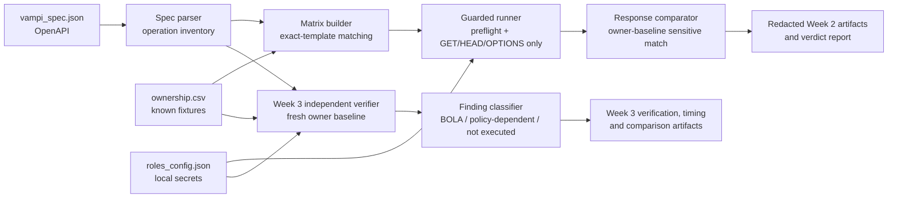

# Báo cáo cuối kỳ — Kiểm thử Broken Access Control cho VAmPI local

**Ngày cập nhật:** 26/10/2026
**Phạm vi thực nghiệm:** VAmPI chạy trong Docker tại `http://127.0.0.1:5000`  
**Nguyên tắc:** chỉ kiểm thử lab được ủy quyền, chỉ dùng fixture đã biết, không quét mục tiêu bên ngoài.

> Báo cáo này chỉ nêu các quan sát đã được tạo artifact và kiểm chứng trong lab. Nó không khẳng định kết quả áp dụng cho mọi API, không coi trạng thái ZAP `NOT_RUN` là bằng chứng âm tính.

---

## Phần 1. Bài toán và tổng quan nghiên cứu

### 1.1. Bối cảnh bài toán

API REST thường nhận định danh object trong path hoặc body, ví dụ tên sách, mã đơn hàng hay tên người dùng. Xác thực thành công chỉ cho biết caller có danh tính hợp lệ; nó không tự chứng minh caller được phép thao tác trên object đích. Nếu API tra object bằng định danh do client cung cấp mà không ràng buộc truy vấn với subject đã xác thực, một người dùng thường có thể đọc hoặc thay đổi dữ liệu của người khác. Đây là dạng Broken Object Level Authorization (BOLA), cũng thường được thảo luận dưới tên Insecure Direct Object Reference (IDOR).

Việc tự động hóa kiểm thử authorization khó hơn việc chỉ gửi một request bất thường. OpenAPI có thể mô tả path, method, schema và đôi khi mô tả `security`, nhưng thường không biểu diễn đầy đủ quan hệ nghiệp vụ như "userA sở hữu book X" hoặc ngoại lệ "admin có thể đọc mọi book". Vì vậy, một HTTP `200` từ cross-user request chưa đủ để kết luận lỗi: cần có owner baseline, dữ liệu nhạy cảm có thể đối chiếu, và policy rõ ràng cho từng role.

Trong dự án này, bài toán được giới hạn có chủ đích: dùng VAmPI là API dễ tổn thương phục vụ đào tạo, chạy cục bộ trong Docker; chỉ dùng hai book fixture có nguồn gốc ownership rõ ràng trong CSV; chỉ thực thi request đọc. Mục tiêu không phải tạo scanner áp dụng tùy ý cho Internet, mà là thiết kế quy trình có thể tái lập để phát hiện và giải thích BOLA trong môi trường được ủy quyền.

### 1.2. Thách thức của kiểm thử authorization dựa trên API specification

Nghiên cứu về xử lý API specification cho thấy OpenAPI là một nguồn đầu vào hữu ích để trích xuất operation và tạo test có cấu trúc [1]. Tuy nhiên, specification không thay thế được semantic policy: thông tin sở hữu object, quan hệ giữa role và object, hoặc ngoại lệ nghiệp vụ thường nằm ngoài schema. Với các hệ thống app–cloud, kiểm soát truy cập đứt gãy còn có thể phát sinh ở biên tương tác giữa nhiều thành phần, làm cho việc quan sát request/response đơn lẻ càng thiếu ngữ cảnh [2].

Các công trình về IDOR nhấn mạnh nhu cầu vừa phát hiện vừa remediation theo ngữ cảnh API và authorization rule [3]. Santos Filho *et al.* (2025) trình bày hướng phát hiện BOLA tự động cho REST API bằng chuyển đổi OpenAPI sang colored Petri nets [4]. Hướng này cho thấy giá trị của mô hình hóa luồng và trạng thái; tuy nhiên, bản thân OpenAPI vẫn cần được kết hợp với thông tin policy/ownership để đánh giá đúng ý nghĩa của một response thành công.

Một nhánh nghiên cứu khác tập trung suy luận hoặc reverse-engineer policy role-based từ ứng dụng web [5], trong khi các nghiên cứu về business rule authorization tìm cách khám phá rule để nhận diện logic flaw [6]. Các hướng đó củng cố một điểm thiết kế của dự án: không suy đoán ownership từ identifier, không tự nâng một admin access thành lỗ hổng, và giữ policy-dependent behavior ở trạng thái cần xác nhận.

### 1.3. Khoảng trống thực hành và mục tiêu dự án

Từ góc nhìn thực hành, một quy trình đào tạo cần dung hòa ba yêu cầu:

1. **Tái sử dụng được:** đọc endpoint từ OpenAPI thay vì hard-code danh sách request.
2. **Có ngữ cảnh ownership:** dùng fixture map có provenance để biết owner, actor và object được phép kiểm thử.
3. **An toàn:** không enumeration, không fuzzing, không state-changing request và không ghi credential vào artifact.

Do đó, dự án sử dụng `ownership.csv` làm nguồn input chuẩn cho ma trận authorization. CSV nêu rõ `resource_type`, `resource_id`, `owner_role`, `owner_username` và `path_template`; endpoint chỉ được đưa vào matrix khi `path_template` trùng **chính xác** template trong OpenAPI.

---

## Phần 2. Thiết kế giải pháp và thuật toán ma trận authorization

### 2.1. Phạm vi, input và output

Giải pháp là CLI `vampi-authz-lab`, chỉ chấp nhận base URL chính xác `http://127.0.0.1:5000`. Ba input chính là:

| Input | Vai trò | Ràng buộc |
| --- | --- | --- |
| `vampi_spec.json` | OpenAPI 3.0.1 từ VAmPI local | Dùng lập inventory operation; không tự suy diễn policy đầy đủ |
| `ownership.csv` | Fixture ownership có provenance | Là input duy nhất để tạo object test; không thay thế bằng enumeration |
| `roles_config.json` | Username và bearer token role local | Secret, mode `0600`, không được export hoặc commit |

### 2.2. Kiến trúc



### 2.3. Guardrail an toàn

| Kiểm soát | Cách thực hiện |
| --- | --- |
| Target allowlist | Từ chối mọi host, scheme, port khác `http://127.0.0.1:5000` |
| Fixture-only | Chỉ dùng `resource_id` có trong `ownership.csv` |
| Read-only execution | Runner chỉ cho `GET`, `HEAD`, `OPTIONS`; chặn `POST`, `PUT`, `PATCH`, `DELETE` |
| Reset protection | `GET /createdb` bị cấm vĩnh viễn |
| Token hygiene | Output writer từ chối JSON có bearer/JWT-like token |
| Preflight | Kiểm tra `vulnerable=1`, identity mỗi role, quyền owner với book fixture |
| Policy separation | Admin cross-access ghi policy-dependent, không tự động là finding |
| BFLA isolation | Target disposable `127.0.0.1:5003` riêng; `assert_disposable_target()` chặn fixture username |

### 2.4. Thuật toán tạo matrix

```text
Input: endpoints E, fixtures F, roles R
Output: fixture-backed test matrix T

for each endpoint e in E:
    if e.method not in {GET, HEAD, OPTIONS} or e.path == "/createdb":
        mark e disabled; continue

    for each fixture f in F where f.path_template == e.path:
        concrete_path = substitute only f.resource_id into e.path

        if e is authenticated book-object read:
            append owner-control(owner(f), concrete_path) to T
            for each role r in R where r != owner(f):
                append cross-user(r, concrete_path) to T
            append anonymous(concrete_path) to T
            append invalid-token(concrete_path) to T
        elif e is public object read:
            append public-observation(concrete_path) to T
```

### 2.5. Quy tắc so sánh và phân loại

Một cross-user BOLA chỉ có verdict `CONFIRMED` khi đồng thời:

1. Owner control tương ứng tồn tại.
2. Response cross-user là HTTP thành công.
3. Response có sensitive field được nhận diện (`secret`, `password`, `token`, `auth_token`).
4. Giá trị tại đúng JSON path của sensitive field bằng owner baseline.

HTTP `200` không tự động được tính là BOLA. Negative control nhận `401`/`403`/`404` phân loại `DENIED`; public ghi `OBSERVATION`.

---

## Phần 3. Kết quả thực nghiệm

### 3.1. Tổng hợp finding

| Mã | Loại | Phương pháp xác nhận | Trạng thái |
| --- | --- | --- | --- |
| W2-01 / W3-01 | BOLA: `userB` đọc book của `userA`; `userA` đọc book của `userB` | Script owner-baseline, xác minh độc lập Tuần 3 và Postman thủ công (M-02, M-03) | **Confirmed** — ba nguồn evidence độc lập |
| W3-02 | Admin truy cập book user khác | Script | Policy-dependent; chưa xếp hạng |
| W3-03 / Tuần 4 | BFLA: `DELETE /users/v1/{username}` | BFLA disposable workflow, có positive và negative control | `DENIED_CONTROL` — không xác nhận BFLA |
| — | Public profile: `GET /users/v1/{username}` | Observation; OpenAPI khai báo public | Observation, không phải BOLA |
| — | ZAP: owner access trên hai book path bị gắn `ILLEGAL` | ZAP Access Control rule-based | Rule-alignment discrepancy, không phải BOLA mới |
| — | ZAP: ba row `/me` bị gắn `ILLEGAL` | ZAP Access Control rule-based | Rule-alignment discrepancy, không phải BOLA mới |

### 3.2. Script tự phát triển (Tuần 2–3)

Script read-only thực thi 12 case trong **1990.362 ms**. Nó xác nhận hai BOLA user-to-user bằng cách so sánh fresh owner baseline với response cross-user tại JSON path `$.secret`. Đây là phương pháp chủ động duy nhất trong ba phương pháp có khả năng chứng minh trực tiếp việc rò rỉ dữ liệu ẩn sau HTTP `200`, thay vì chỉ suy luận từ status code hay rule scanner.

Hai case xác nhận là `userB → book userA` và `userA → book userB`. Hai request admin cross-user được giữ riêng ở trạng thái policy-dependent: kết quả chỉ trở thành finding nếu policy xác nhận admin không được phép bypass ownership.

### 3.3. Kiểm thử thủ công bằng Postman (Tuần 3)

Cả 7/7 case Postman đã hoàn thành. M-02 xác nhận `userB` đọc book của `userA`; M-03 xác nhận `userA` đọc book của `userB`. Hai kết quả này khớp hoàn toàn với script; M-04 và M-05 là negative control bị từ chối, M-06 là public-profile observation và M-07 là identity control pass.

Trạng thái evidence là `COMPLETED_NO_TIMING`: có kết quả định tính đầy đủ nhưng không có số đo stopwatch. Vì vậy, Postman được dùng làm xác minh chức năng độc lập, không được gán một metric thời gian suy diễn từ script.

### 3.4. OWASP ZAP Access Control (Tuần 4)

Sau cấu hình Context bị thu hẹp còn năm URL, Manual Authentication qua JSON login, Header-based Session Management, Forced User Mode để xác minh thủ công, quiescence và history-containment gate, cùng các sửa lỗi response contract cho `core.accessUrl` và `accessControl/action/writeHTMLreport`, ZAP Access Control hoàn tất assessment với 15 result rows (5 path × 3 user). Containment đầy đủ: 15 request scan-delta đều là `GET` thuộc allowlist và `violation_counts` rỗng.

Tuy nhiên, kết quả phải được diễn giải theo actor cụ thể, không theo path đơn thuần:

- ZAP gắn `ILLEGAL` cho cả hai book path, nhưng actor bị gắn cờ là **owner**: `userA` trên book của `userA` và `userB` trên book của `userB`. Đây không phải hai actor cross-user (`userB → book userA`, `userA → book userB`) đã được script và Postman xác nhận là BOLA.
- Artifact không xuất bất kỳ `ILLEGAL` row nào cho `admin` trên hai book path. Vì artifact redacted chỉ giữ row `ILLEGAL`, bốn tổ hợp book-user còn lại không được kết luận là `VALID`; chúng chỉ không xuất hiện trong finding.
- Cả ba row `/me` bị gắn `ILLEGAL`, dù expected self-control là mỗi reviewed user được phép xem `/me` của chính họ.

Do đó, ZAP cung cấp tín hiệu ở mức endpoint và bằng chứng về sự lệch giữa reviewed rule với observed authorization; nó **không xác nhận độc lập** đúng hai test case BOLA cross-user. Owner-book và `/me` là scanner-labeled anomalies cần điều tra mapping/context, không phải BOLA mới. Một khả năng cần kiểm chứng là Access Rule self/owner bị cấu hình hoặc diễn giải ngược chiều, nhưng artifact hiện có không đủ để khẳng định nguyên nhân gốc rễ.

### 3.5. BFLA disposable (Tuần 4)

BFLA được thực thi thật trên môi trường disposable tách biệt khỏi shared lab. Non-admin `DELETE` protected victim nhận `401` và victim vẫn tồn tại (negative control); admin `DELETE` disposable control nhận `200` và control bị xóa (positive control). Kết luận là **`DENIED_CONTROL`**: không có BFLA được xác nhận trong case đã test.

---

## Phần 4. Đánh giá, so sánh và hướng tiếp theo

### 4.1. Bảng so sánh bốn phương pháp

| Tiêu chí | Script tự phát triển | Thủ công (Postman) | OWASP ZAP | BFLA disposable |
| --- | --- | --- | --- | --- |
| Xác nhận đúng 2 BOLA user-to-user | Có — owner-baseline | Có — độc lập (M-02, M-03) | Không — actor mapping lệch | N/A |
| Phát hiện rò rỉ ẩn sau `200 OK` | Có — so sánh `$.secret` trực tiếp | Có — quan sát response có chủ đích | Chỉ đánh giá rule Allow/Deny; không so sánh nội dung | N/A |
| Effort cấu hình | Trung bình: viết một lần, tái sử dụng | Thấp mỗi case, nhưng không scale | Rất cao: Context, auth, quiescence, seed và report-write phải khớp | Trung bình: fixture disposable và guardrail riêng |
| Thời gian | 1990.362 ms / 12 case | Không đo stopwatch | Vài giờ công cấu hình; assessment chạy trong vài giây | N/A |
| Khả năng tái sử dụng | Cao — đổi spec/role/ownership | Thấp — thực hiện lại thủ công | Trung bình — Context cần review lại khi đổi fixture | Guardrail tái dùng được; fixture phải tạo mới |

### 4.2. Luận điểm trung tâm được củng cố mạnh hơn dự kiến

Quá trình vận hành ZAP trong Tuần 4 cho thấy kiểm thử authorization logic không phải là một scanner “bấm nút là xong”. Session management phải phản ánh đúng cơ chế header-based của ứng dụng; API response contract thực tế của `core.accessUrl` và `writeHTMLreport` khác generic acknowledgement giả định ban đầu; còn kết quả cuối cùng phải được đọc ở cấp actor×resource thay vì chỉ đếm endpoint bị gắn cờ.

Ngay cả khi scan có containment đầy đủ, một công cụ rule-based vẫn chỉ mạnh bằng Context, authentication state, Access Rules và cách người vận hành diễn giải output của nó. Kết quả owner-book và `/me` `ILLEGAL` minh họa rằng scanner có thể tạo actor-level signal không khớp bản chất logic flaw cần tìm. Vì vậy, script owner-baseline và xác minh thủ công vẫn cần thiết để chứng minh data disclosure thực tế.

### 4.3. Giới hạn

- ZAP Access Control không thay thế được owner-baseline confirmation: nó chỉ bổ sung evidence về rule alignment; ba `/me` discrepancy và hai owner-book discrepancy chưa được điều tra đến nguyên nhân gốc rễ.
- Đo thủ công thiếu số liệu thời gian định lượng.
- Ownership map vẫn được xây dựng thủ công; OpenAPI có thể thiếu security declaration như hướng cải thiện của Barabanov và Dergunov (2022).
- BFLA mới phủ một action `DELETE` trên một fixture disposable.
- Các tổng số giữa 12 automated case, 7 manual case, 15 ZAP row và 2 BFLA control không phải các sample hoàn toàn hoán đổi cho nhau.

### 4.4. Hướng tiếp theo

1. Review thủ công Access Rule mapping trong ZAP Context để xác định vì sao owner access và `/me` bị gắn sai hướng; đây có thể là lỗi cấu hình Allow/Deny hoặc giới hạn đánh giá self-identity của add-on.
2. Bán tự động hóa ownership map theo hướng Le và cộng sự (2022), đồng thời vẫn yêu cầu review provenance trước khi test.
3. Mở rộng đánh giá sang kiến trúc multi-service thực tế như crAPI theo hướng Zhang và cộng sự (2024).
4. Nếu so sánh hiệu quả thao tác là yêu cầu, thực hiện lại Postman với stopwatch độc lập thay vì suy diễn từ runtime của script.

## Tài liệu tham khảo

[1] A. Barabanov and D. Dergunov, "Automatic Detection of Access Control Vulnerabilities via API Specification Processing," *Voprosy kiberbezopasnosti*, 2022, doi: 10.21681/2311-3456-2022-1-49-65.

[2] Z. Zhang, F. Zou, J. Hong, L. Chen, and P. Yi, "Detection and Analysis of Broken Access Control Vulnerabilities in App–Cloud Interaction in IoT," *IEEE Internet of Things Journal*, vol. 11, no. 17, pp. 28267–28280, Sep. 2024, doi: 10.1109/JIOT.2024.3400858.

[3] S. Yulianto, R. R. Abdullah, and B. Soewito, "Comprehensive Analysis and Remediation of Insecure Direct Object References (IDOR) Vulnerabilities in Android APIs," in *2023 IEEE International Conference on Cryptography, Informatics, and Cybersecurity (ICoCICs)*, Bogor, Indonesia, Aug. 2023, pp. 23–28, doi: 10.1109/ICoCICs58778.2023.10276919.

[4] A. Santos Filho, R. J. Rodríguez, and E. L. Feitosa, "Automated broken object-level authorization attack detection in REST APIs through OpenAPI to colored petri nets transformation," *International Journal of Information Security*, vol. 24, no. 2, art. 83, 2025, doi: 10.1007/s10207-024-00970-5.

[5] H. T. Le, L. K. Shar, D. Bianculli, L. C. Briand, and C. D. Nguyen, "Automated reverse engineering of role-based access control policies of web applications," *Journal of Systems and Software*, vol. 184, art. 111109, Feb. 2022, doi: 10.1016/j.jss.2021.111109.

[6] H. Alkofahi, D. Umphress, and H. Alawneh, "Discovering Authorization Business Rules toward Detecting Web Applications Logic Flaws," in *2022 International Arab Conference on Information Technology (ACIT)*, pp. 1–7, Nov. 2022, doi: 10.1109/ACIT57182.2022.9994086.
