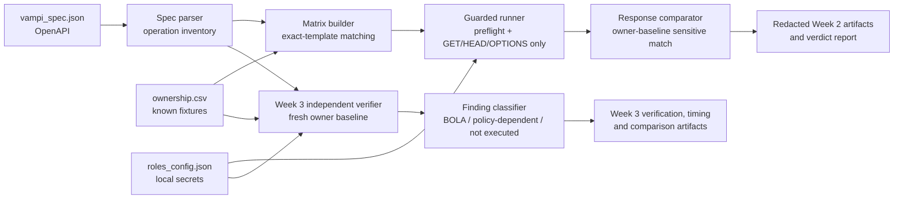

# Báo cáo cuối kỳ — Kiểm thử Broken Access Control cho VAmPI local

**Ngày cập nhật:** 22/10/2026  
**Phạm vi thực nghiệm:** VAmPI chạy trong Docker tại `http://127.0.0.1:5000`  
**Nguyên tắc:** chỉ kiểm thử lab được ủy quyền, chỉ dùng fixture đã biết, không quét mục tiêu bên ngoài.

> Báo cáo này chỉ nêu các quan sát đã được tạo artifact và kiểm chứng trong lab. Nó không khẳng định kết quả áp dụng cho mọi API, không coi trạng thái ZAP `NOT_RUN` là bằng chứng âm tính.

---

## Phần 1. Bài toán và tổng quan nghiên cứu

### 1.1. Bối cảnh bài toán

API REST thường nhận định danh object trong path hoặc body, ví dụ tên sách, mã đơn hàng hay tên người dùng. Xác thực thành công chỉ cho biết caller có danh tính hợp lệ; nó không tự chứng minh caller được phép thao tác trên object đích. Nếu API tra object bằng định danh do client cung cấp mà không ràng buộc truy vấn với subject đã xác thực, một người dùng thường có thể đọc hoặc thay đổi dữ liệu của người khác. Đây là dạng Broken Object Level Authorization (BOLA), cũng thường được thảo luận dưới tên Insecure Direct Object Reference (IDOR).

Việc tự động hóa kiểm thử authorization khó hơn việc chỉ gửi một request bất thường. OpenAPI có thể mô tả path, method, schema và đôi khi mô tả `security`, nhưng thường không biểu diễn đầy đủ quan hệ nghiệp vụ như "userA sở hữu book X" hoặc ngoại lệ "admin có thể đọc mọi book". Vì vậy, một HTTP `200` từ cross-user request chưa đủ để kết luận lỗi: cần có owner baseline, dữ liệu nhạy cảm có thể đối chiếu, và policy rõ ràng cho từng role.

Trong dự án này, bài toán được giới hạn có chủ đích: dùng VAmPI là API dễ tổn thương phục vụ đào tạo, chạy cục bộ trong Docker; chỉ dùng hai book fixture có nguồn gốc ownership rõ ràng trong CSV; chỉ thực thi request đọc. Mục tiêu không phải tạo scanner áp dụng tùy ý cho Internet, mà là thiết kế quy trình có thể tái lập để phát hiện và giải thích BOLA trong môi trường được ủy quyền.

### 1.2. Thách thức của kiểm thử authorization dựa trên API specification

Nghiên cứu về xử lý API specification cho thấy OpenAPI là một nguồn đầu vào hữu ích để trích xuất operation và tạo test có cấu trúc [1]. Tuy nhiên, specification không thay thế được semantic policy: thông tin sở hữu object, quan hệ giữa role và object, hoặc ngoại lệ nghiệp vụ thường nằm ngoài schema. Với các hệ thống app–cloud, kiểm soát truy cập đứt gãy còn có thể phát sinh ở biên tương tác giữa nhiều thành phần, làm cho việc quan sát request/response đơn lẻ càng thiếu ngữ cảnh [2].

Các công trình về IDOR nhấn mạnh nhu cầu vừa phát hiện vừa remediation theo ngữ cảnh API và authorization rule [3]. Santos Filho *et al.* (2025) trình bày hướng phát hiện BOLA tự động cho REST API bằng chuyển đổi OpenAPI sang colored Petri nets [4]. Hướng này cho thấy giá trị của mô hình hóa luồng và trạng thái; tuy nhiên, bản thân OpenAPI vẫn cần được kết hợp với thông tin policy/ownership để đánh giá đúng ý nghĩa của một response thành công.

Một nhánh nghiên cứu khác tập trung suy luận hoặc reverse-engineer policy role-based từ ứng dụng web [5], trong khi các nghiên cứu về business rule authorization tìm cách khám phá rule để nhận diện logic flaw [6]. Các hướng đó củng cố một điểm thiết kế của dự án: không suy đoán ownership từ identifier, không tự nâng một admin access thành lỗ hổng, và giữ policy-dependent behavior ở trạng thái cần xác nhận.

### 1.3. Khoảng trống thực hành và mục tiêu dự án

Từ góc nhìn thực hành, một quy trình đào tạo cần dung hòa ba yêu cầu:

1. **Tái sử dụng được:** đọc endpoint từ OpenAPI thay vì hard-code danh sách request.
2. **Có ngữ cảnh ownership:** dùng fixture map có provenance để biết owner, actor và object được phép kiểm thử.
3. **An toàn:** không enumeration, không fuzzing, không state-changing request và không ghi credential vào artifact.

Do đó, dự án sử dụng `ownership.csv` làm nguồn input chuẩn cho ma trận authorization. CSV nêu rõ `resource_type`, `resource_id`, `owner_role`, `owner_username` và `path_template`; endpoint chỉ được đưa vào matrix khi `path_template` trùng **chính xác** template trong OpenAPI.

---

## Phần 2. Thiết kế giải pháp và thuật toán ma trận authorization

### 2.1. Phạm vi, input và output

Giải pháp là CLI `vampi-authz-lab`, chỉ chấp nhận base URL chính xác `http://127.0.0.1:5000`. Ba input chính là:

| Input | Vai trò | Ràng buộc |
| --- | --- | --- |
| `vampi_spec.json` | OpenAPI 3.0.1 từ VAmPI local | Dùng lập inventory operation; không tự suy diễn policy đầy đủ |
| `ownership.csv` | Fixture ownership có provenance | Là input duy nhất để tạo object test; không thay thế bằng enumeration |
| `roles_config.json` | Username và bearer token role local | Secret, mode `0600`, không được export hoặc commit |

### 2.2. Kiến trúc



### 2.3. Guardrail an toàn

| Kiểm soát | Cách thực hiện |
| --- | --- |
| Target allowlist | Từ chối mọi host, scheme, port khác `http://127.0.0.1:5000` |
| Fixture-only | Chỉ dùng `resource_id` có trong `ownership.csv` |
| Read-only execution | Runner chỉ cho `GET`, `HEAD`, `OPTIONS`; chặn `POST`, `PUT`, `PATCH`, `DELETE` |
| Reset protection | `GET /createdb` bị cấm vĩnh viễn |
| Token hygiene | Output writer từ chối JSON có bearer/JWT-like token |
| Preflight | Kiểm tra `vulnerable=1`, identity mỗi role, quyền owner với book fixture |
| Policy separation | Admin cross-access ghi policy-dependent, không tự động là finding |
| BFLA isolation | Target disposable `127.0.0.1:5003` riêng; `assert_disposable_target()` chặn fixture username |

### 2.4. Thuật toán tạo matrix

```text
Input: endpoints E, fixtures F, roles R
Output: fixture-backed test matrix T

for each endpoint e in E:
    if e.method not in {GET, HEAD, OPTIONS} or e.path == "/createdb":
        mark e disabled; continue

    for each fixture f in F where f.path_template == e.path:
        concrete_path = substitute only f.resource_id into e.path

        if e is authenticated book-object read:
            append owner-control(owner(f), concrete_path) to T
            for each role r in R where r != owner(f):
                append cross-user(r, concrete_path) to T
            append anonymous(concrete_path) to T
            append invalid-token(concrete_path) to T
        elif e is public object read:
            append public-observation(concrete_path) to T
```

### 2.5. Quy tắc so sánh và phân loại

Một cross-user BOLA chỉ có verdict `CONFIRMED` khi đồng thời:

1. Owner control tương ứng tồn tại.
2. Response cross-user là HTTP thành công.
3. Response có sensitive field được nhận diện (`secret`, `password`, `token`, `auth_token`).
4. Giá trị tại đúng JSON path của sensitive field bằng owner baseline.

HTTP `200` không tự động được tính là BOLA. Negative control nhận `401`/`403`/`404` phân loại `DENIED`; public ghi `OBSERVATION`.

---

## Phần 3. Hướng dẫn tái hiện từng tuần

### Tuần 1 — Cài đặt môi trường

#### Mục tiêu
Dựng Docker lab VAmPI local, tạo tài khoản `admin`, `userA`, `userB` và book fixture.

#### Điều kiện
- Docker đã cài đặt.
- Không cần Internet sau khi pull image lần đầu.

#### Các bước

```bash
# 1. Build image VAmPI từ source
cd VAmPI-source
docker build -t vampi-week1:local .
cd ..

# 2. Chạy container
docker run -d --name vampi-week1 \
  -p 127.0.0.1:5000:5000 \
  -e vulnerable=1 \
  vampi-week1:local

# 3. Khởi tạo database
curl -s http://127.0.0.1:5000/createdb

# 4. Tạo tài khoản (thay <password> bằng mật khẩu tự chọn)
curl -s -X POST http://127.0.0.1:5000/users/v1/register \
  -H 'Content-Type: application/json' \
  -d '{"username":"userA","password":"<passwordA>","email":"a@local.lab"}'

curl -s -X POST http://127.0.0.1:5000/users/v1/register \
  -H 'Content-Type: application/json' \
  -d '{"username":"userB","password":"<passwordB>","email":"b@local.lab"}'

# 5. Đăng nhập lấy token (ghi vào roles_config.json, mode 0600)
curl -s -X POST http://127.0.0.1:5000/users/v1/login \
  -H 'Content-Type: application/json' \
  -d '{"username":"userA","password":"<passwordA>"}'
# → ghi auth_token vào roles_config.json

# 6. Tạo book fixture
curl -s -X POST http://127.0.0.1:5000/books/v1 \
  -H 'Content-Type: application/json' \
  -H 'Authorization: Bearer <tokenUserA>' \
  -d '{"book_title":"week1-userA-book","secret":"<secret-value-A>"}'

curl -s -X POST http://127.0.0.1:5000/books/v1 \
  -H 'Content-Type: application/json' \
  -H 'Authorization: Bearer <tokenUserB>' \
  -d '{"book_title":"week1-userB-book","secret":"<secret-value-B>"}'

# 7. Lấy OpenAPI spec
curl -s http://127.0.0.1:5000/openapi.json > vampi_spec.json

# 8. Tạo ownership.csv
cat > ownership.csv << 'EOF'
resource_type,resource_id,owner_role,owner_username,path_template
book,week1-userA-book,user,userA,/books/v1/{book_title}
book,week1-userB-book,user,userB,/books/v1/{book_title}
EOF

# 9. Tạo roles_config.json (mode 0600, KHÔNG commit)
# Format: {"admin":{"username":"admin","token":"..."},
#          "userA":{"username":"userA","token":"..."},
#          "userB":{"username":"userB","token":"..."}}
chmod 600 roles_config.json
```

#### Artifact Tuần 1
- `vampi_spec.json` — OpenAPI spec
- `ownership.csv` — fixture ownership map
- `roles_config.json` — secret, mode `0600`

---

### Tuần 2 — Pipeline kiểm thử authorization tự động

#### Mục tiêu
Chạy ma trận authorization read-only 12 case, phát hiện BOLA.

#### Điều kiện
- Tuần 1 hoàn thành; `vampi-week1` đang chạy.
- Python ≥ 3.10.

#### Các bước

```bash
# 1. Cài package
python3 -m venv .venv
.venv/bin/python -m pip install .

# 2. Kiểm tra input
.venv/bin/vampi-authz-lab check-inputs

# 3. Chạy pipeline
python3 -I week2/main.py --base-url http://127.0.0.1:5000
# hoặc:
.venv/bin/vampi-authz-lab run

# 4. Chạy unit test
python3 -I -m unittest discover -s tests -v
```

#### Artifact Tuần 2
- `results/endpoint_inventory.json`
- `results/ownership_map.json`
- `results/test_matrix.json`
- `results/preflight.json`
- `results/raw_results.json`
- `results/final_report.json`

#### Kết quả chính
- 12 case read-only; 2 BOLA user-to-user confirmed.
- Admin cross-user: policy-dependent.
- Anonymous/invalid-token: DENIED.
- Public profile: OBSERVATION.

---

### Tuần 3 — Xác minh độc lập, đo thủ công và đánh giá ZAP

#### Mục tiêu
Xác minh BOLA bằng fresh baseline độc lập, đo thủ công 7 case bằng Postman, đánh giá ZAP.

#### Điều kiện
- Tuần 2 hoàn thành; `vampi-week1` đang chạy.

#### Các bước — Script xác minh

```bash
# 1. Chạy pipeline Tuần 3
python3 -I week3/run_week3.py
# hoặc:
.venv/bin/vampi-authz-lab week3

# 2. Chạy rerun đóng gói (tùy chọn)
.venv/bin/vampi-authz-lab week3 --output-dir results/rerun-week3
```

#### Các bước — Đo thủ công Postman

1. Mở Postman, tạo Environment `VAmPI Local`:
   - `baseUrl` = `http://127.0.0.1:5000`
   - `tokenUserA` = (Current Value only)
   - `tokenUserB` = (Current Value only)

2. Đăng nhập lấy token:
   - `POST {{baseUrl}}/users/v1/login` → body `{"username":"userA","password":"<password>"}`
   - Copy `auth_token` vào `tokenUserA` Current Value.
   - Lặp lại cho `userB`.

3. Tạo 7 request GET:
   - M-01: `GET {{baseUrl}}/books/v1/week1-userA-book` — Bearer `{{tokenUserA}}`
   - M-02: `GET {{baseUrl}}/books/v1/week1-userA-book` — Bearer `{{tokenUserB}}`
   - M-03: `GET {{baseUrl}}/books/v1/week1-userB-book` — Bearer `{{tokenUserA}}`
   - M-04: `GET {{baseUrl}}/books/v1/week1-userA-book` — No Auth
   - M-05: `GET {{baseUrl}}/books/v1/week1-userA-book` — Bearer `invalid-token-value`
   - M-06: `GET {{baseUrl}}/users/v1/userA` — No Auth
   - M-07: `GET {{baseUrl}}/me` — Bearer `{{tokenUserA}}`

4. Gửi từng request, đọc response, ghi status/ghi chú vào `results/week3_manual_worksheet.md`.

5. Sau khi xong, xóa Current Value token. Không export nếu còn token.

#### Artifact Tuần 3
- `results/week3_manual_verification.json`
- `results/week3_findings.json`
- `results/week3_script_timing.json`
- `results/week3_comparison.json`
- `results/week3_manual_worksheet.md`
- `results/zap/zap_run_status.json`

#### Kết quả chính
- Script: 2 BOLA confirmed (fresh baseline).
- Thủ công: 2 BOLA confirmed (M-02, M-03), cùng kết luận với script.
- ZAP: `NOT_RUN` do Site Tree containment.

---

### Tuần 4 — BFLA disposable và bảng so sánh

#### Mục tiêu
Thực thi BFLA thật trên môi trường disposable, hoàn chỉnh bảng so sánh bốn phương pháp.

#### Điều kiện
- Tuần 3 hoàn thành.
- Docker Compose đã cài đặt.
- Port `5003` trống.
- Image `vampi-week1:local` đã có.

#### Các bước — BFLA disposable

```bash
# 1. Tạo manifest
.venv/bin/vampi-bfla-disposable create-manifest --run-id <run-id>

# 2. Preflight
.venv/bin/vampi-bfla-disposable preflight --run-id <run-id>

# 3. Khởi tạo container disposable
docker compose \
  --project-name vampi-bfla-<run-id> \
  --file bfla-disposable/compose.yaml \
  up --detach --wait --wait-timeout 60

# 4. Chuẩn bị fixture
.venv/bin/vampi-bfla-disposable prepare --run-id <run-id>

# 5. Thực thi DELETE test
.venv/bin/vampi-bfla-disposable execute --run-id <run-id>

# 6. Dọn dẹp (LUÔN chạy)
.venv/bin/vampi-bfla-disposable teardown --run-id <run-id>

# 7. Tạo artifact Tuần 4
python3 -I week4/run_week4.py --run-id <run-id> --skip-zap
```

#### Các bước — ZAP (tùy chọn, chỉ sau Desktop review)

Không chạy runner cũ chỉ với API key. Trước tiên phải tạo/review/export private imported Context có đúng 3 user và 5 Access Rule scope, tạo fingerprint attestation không chứa secret, rồi mount Context read-only và output tạm thời. Quy trình Fish hoàn chỉnh, tên tham số và điều kiện containment nằm tại **mục 3 của `docs/week-4-report.md`**. Nếu không có Context/attestation hợp lệ, runner phải ghi `NOT_RUN` và không gọi scan.

#### Artifact Tuần 4
- `results/bfla-disposable/<run-id>/execution-receipt.json`
- `results/bfla-disposable/<run-id>/teardown-receipt.json`
- `results/week4_bfla_findings.json`
- `results/zap/zap_run_status.json`
- `results/week4_comparison_final.json`

#### Kết quả chính
- BFLA: `DENIED_CONTROL` — non-admin bị từ chối, positive control hoạt động.
- ZAP: `NOT_RUN`.
- So sánh hoàn chỉnh: script 2 BOLA + thủ công 2 BOLA + BFLA DENIED_CONTROL.

---

## Phần 4. Thực nghiệm, xác minh và đánh giá kết quả

### 4.1. Kết quả authorization read-only

| Nhóm kết quả | Số case | Diễn giải | Xác minh bởi |
| --- | ---: | --- | --- |
| Owner control book | 2 | `CONTROL_PASS` | Script |
| Cross-user user-to-user | 2 | BOLA `CONFIRMED` | Script + Postman |
| Cross-user admin | 2 | Policy-dependent | Script |
| Anonymous/invalid-token | 4 | `DENIED` | Script + Postman |
| Public profile observation | 2 | `OBSERVATION` | Script + Postman |
| **Tổng** | **12** | | |

Bằng chứng BOLA là equality của trường nhạy cảm `$.secret` giữa response cross-user và fresh owner baseline, không chỉ là HTTP `200`.

Đo thủ công bằng Postman (7 case) tái xác nhận 2 BOLA user-to-user và 2 negative control, khớp hoàn toàn với kết quả script.

### 4.2. Kết quả BFLA trong môi trường disposable

| Control | Kết quả | Diễn giải |
| --- | ---: | --- |
| Non-admin xóa protected victim | HTTP 401; victim còn tồn tại | Authorization control hoạt động |
| Admin xóa delete control | HTTP 200; control không còn | Positive control xác nhận |

**Verdict: `DENIED_CONTROL`** — non-admin bị từ chối. Không xác nhận BFLA.

### 4.3. Kết quả ZAP

Trạng thái evidence hiện tại: `NOT_RUN`. Artifact cũ dừng vì runner cũ đã nhầm node parent cấu trúc trong Site Tree với HTTP request ngoài scope; nó không là finding/negative result. Quy trình thay thế yêu cầu imported Context đã review (3 user + Access Rules), fingerprint attestation private và containment từ paginated HTTP history thực tế; chỉ sau run mới qua toàn bộ gate mới có thể ghi `COMPLETED`.

### 4.4. Bảng so sánh tổng hợp

| Tiêu chí | Script tự phát triển | Thủ công Postman | OWASP ZAP | BFLA disposable |
| --- | --- | --- | --- | --- |
| Trạng thái | MEASURED | COMPLETED_NO_TIMING | NOT_RUN | EXECUTED |
| Số case | 12 | 7 | 0 | 2 |
| BOLA confirmed | 2 | 2 | — | N/A |
| BFLA verdict | N/A | N/A | — | DENIED_CONTROL |
| Thời gian | ~2032 ms | Không đo | — | N/A |
| Phát hiện data leak | Có (`$.secret`) | Có (đọc body) | — | N/A |

---

## Phần 5. Thảo luận, giới hạn và kết luận

### 5.1. Kết luận trong phạm vi thí nghiệm

Trong phạm vi VAmPI local được ủy quyền, quy trình xác minh độc lập xác nhận hai trường hợp BOLA user-to-user tại endpoint book-object. Kết luận này được xác nhận bởi **cả hai phương pháp**: script tự động (fresh baseline sensitive-field comparison) và kiểm tra thủ công Postman (đọc response body trực tiếp).

Thử nghiệm BFLA tách biệt đã xác nhận control từ chối đối với non-admin trong môi trường disposable; không có finding BFLA đã được xác nhận.

ZAP Access Control evidence hiện giữ `NOT_RUN`: runner cũ không có verified imported Context/API lifecycle đúng. Quy trình mới dùng Context đã review và HTTP-history containment; chưa có real-scan artifact mới nên không suy diễn kết quả scanner.

### 5.2. Giá trị và giới hạn

**Giá trị:**
- Kết hợp OpenAPI inventory, ownership fixture có provenance, control case, và sensitive baseline comparison.
- BFLA được cô lập bằng target/volume/project disposable.
- Guardrail defense-in-depth chặn fixture username ở nhiều tầng.
- Kết quả BOLA được xác nhận bởi hai phương pháp độc lập.

**Giới hạn:**
- Ownership map cung cấp thủ công; chỉ hai book fixture cho BOLA.
- OpenAPI không thay thế authorization policy.
- BFLA chỉ phủ một actor, hai target và một operation.
- Thời gian đo thủ công bỏ qua (chỉ phục vụ so sánh phương pháp).
- ZAP Access Control scan chưa chạy thành công.

### 5.3. Khuyến nghị

1. **Remediation BOLA:** ràng buộc truy vấn book với authenticated subject; trả denial/hidden response cho non-owner.
2. **Admin policy:** chỉ nâng thành finding khi policy xác nhận admin bị cấm bypass ownership.
3. **ZAP tương lai:** cần cơ chế kiểm chứng scan queue trước scan; cấu hình user/authentication/rules đầy đủ.
4. **Mở rộng BFLA:** manifest mới, fixture disposable mới, target độc lập; không nới điều kiện runner Week 2/3.

---

## Tài liệu tham khảo

[1] A. Barabanov and D. Dergunov, "Automatic Detection of Access Control Vulnerabilities via API Specification Processing," *Voprosy kiberbezopasnosti*, 2022, doi: 10.21681/2311-3456-2022-1-49-65.

[2] Z. Zhang, F. Zou, J. Hong, L. Chen, and P. Yi, "Detection and Analysis of Broken Access Control Vulnerabilities in App–Cloud Interaction in IoT," *IEEE Internet of Things Journal*, vol. 11, no. 17, pp. 28267–28280, Sep. 2024, doi: 10.1109/JIOT.2024.3400858.

[3] S. Yulianto, R. R. Abdullah, and B. Soewito, "Comprehensive Analysis and Remediation of Insecure Direct Object References (IDOR) Vulnerabilities in Android APIs," in *2023 IEEE International Conference on Cryptography, Informatics, and Cybersecurity (ICoCICs)*, Bogor, Indonesia, Aug. 2023, pp. 23–28, doi: 10.1109/ICoCICs58778.2023.10276919.

[4] A. Santos Filho, R. J. Rodríguez, and E. L. Feitosa, "Automated broken object-level authorization attack detection in REST APIs through OpenAPI to colored petri nets transformation," *International Journal of Information Security*, vol. 24, no. 2, art. 83, 2025, doi: 10.1007/s10207-024-00970-5.

[5] H. T. Le, L. K. Shar, D. Bianculli, L. C. Briand, and C. D. Nguyen, "Automated reverse engineering of role-based access control policies of web applications," *Journal of Systems and Software*, vol. 184, art. 111109, Feb. 2022, doi: 10.1016/j.jss.2021.111109.

[6] H. Alkofahi, D. Umphress, and H. Alawneh, "Discovering Authorization Business Rules toward Detecting Web Applications Logic Flaws," in *2022 International Arab Conference on Information Technology (ACIT)*, pp. 1–7, Nov. 2022, doi: 10.1109/ACIT57182.2022.9994086.
