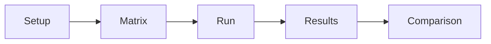
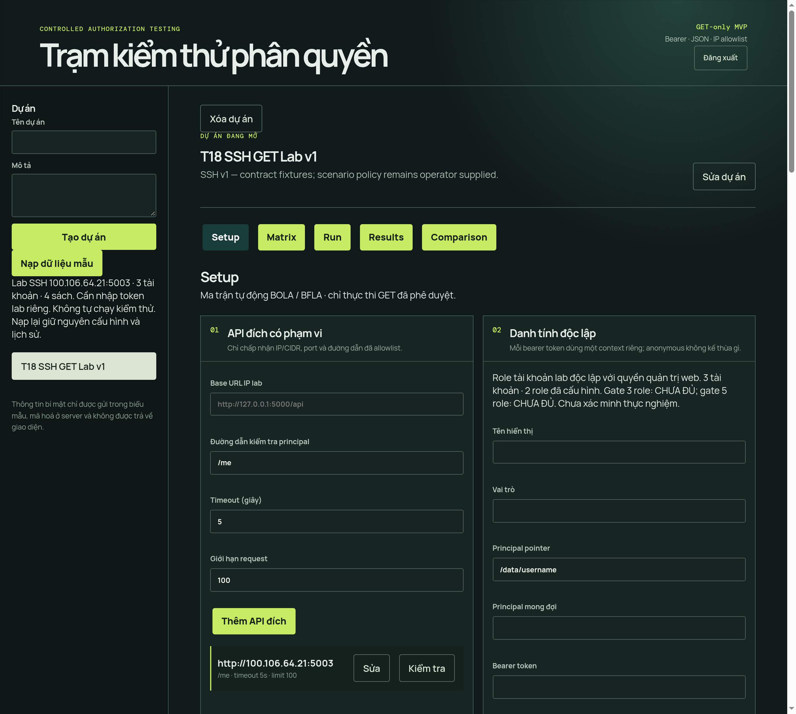
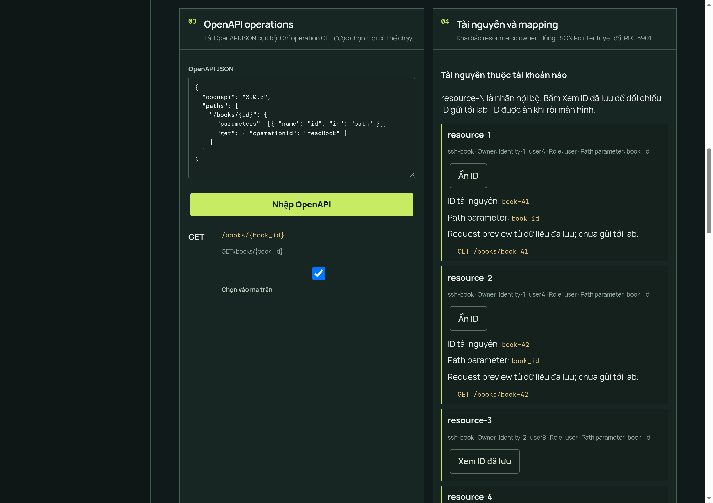
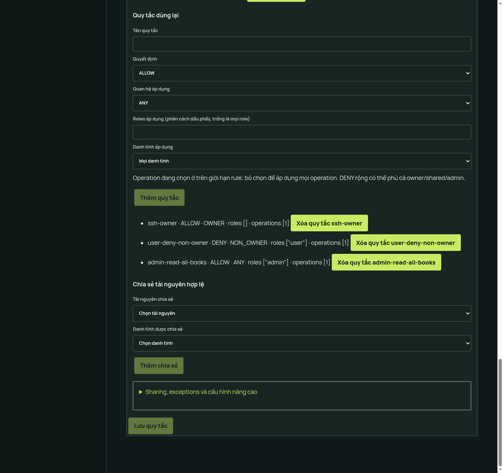
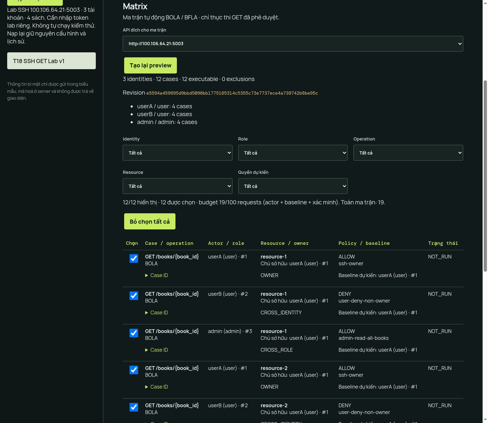
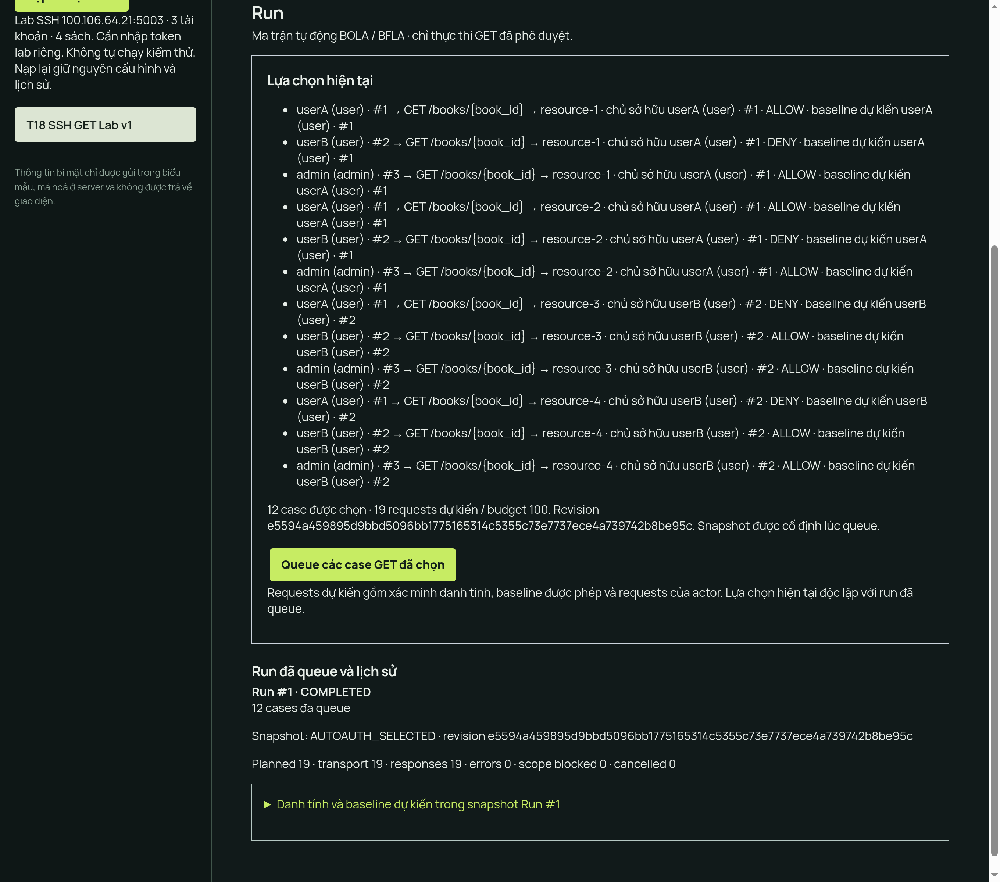
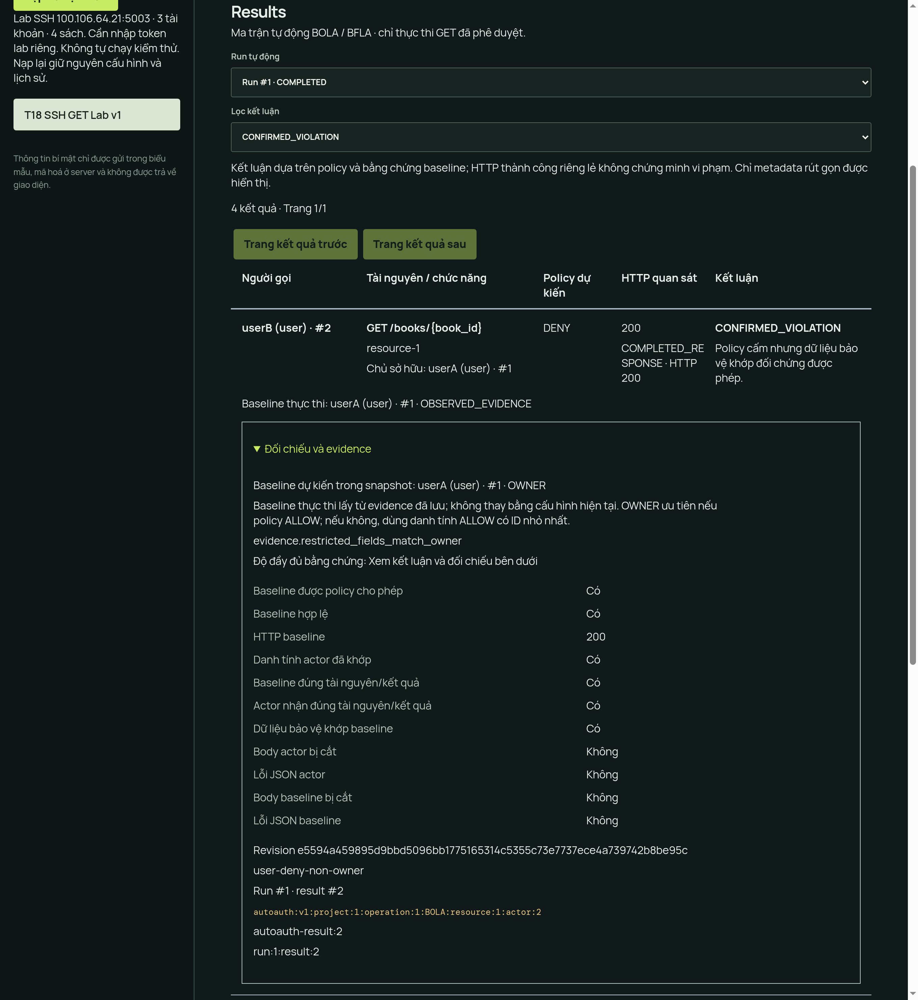
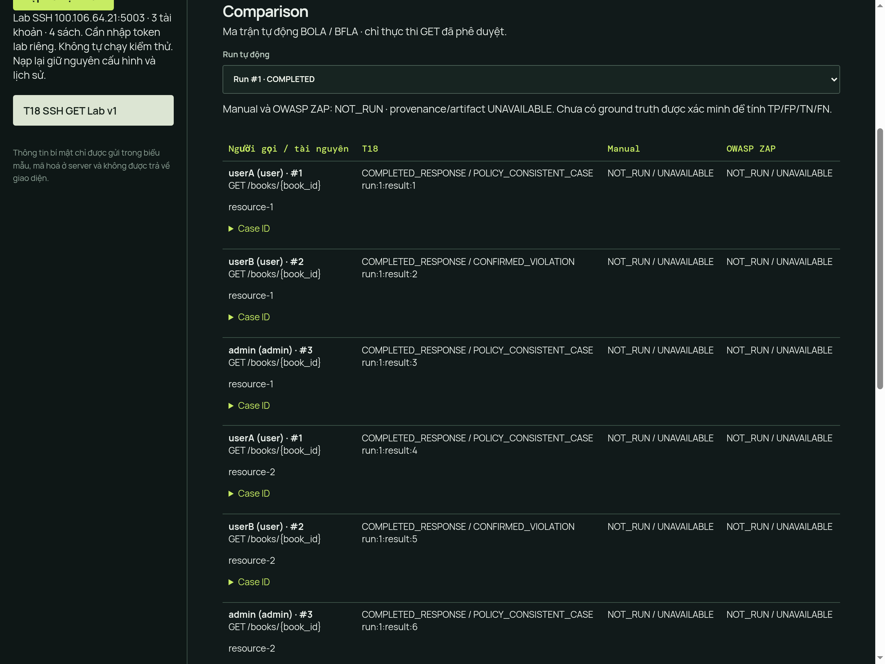

# Hướng dẫn chạy dự án T18 (Web Control Room)

- **Đối tượng sử dụng:** Người vận hành kiểm thử phân quyền trên Web Control Room (`http://127.0.0.1:8000`)
- **Lab tham chiếu:** `T18 SSH GET Lab v1` (`http://100.106.64.21:5003`)
- **Trạng thái tài liệu:** Đã hoàn thiện Phần 1 (Kiểm tra Setup & Matrix), Phần 3 (Đọc kết quả từng mục), Phần 4 (Checklist báo cáo & ranh giới nghiên cứu) và nhật ký thực nghiệm **Run #1, Run #2 (TC-05), Run #3 (TC-07 đối chiếu T18 – OWASP ZAP – Postman)**. Các testcase còn lại (**TC-02, TC-03, TC-04, TC-06**) giữ dạng khung `[TODO]` ở Mục 2.3 để bổ sung sau.

## Mục lục

- [Tổng quan và phạm vi vận hành](#tổng-quan-và-phạm-vi-vận-hành)
- [Phần 1. Kiểm tra Setup và Matrix trước khi chạy](#phần-1-kiểm-tra-setup-và-matrix-trước-khi-chạy)
  - [1.1. Chọn dự án và Nạp dữ liệu mẫu](#11-chọn-dự-án-và-nạp-dữ-liệu-mẫu)
  - [1.2. Trạm `01 API đích có phạm vi` và Trạm `02 Danh tính độc lập`](#12-trạm-01-api-đích-có-phạm-vi-và-trạm-02-danh-tính-độc-lập)
  - [1.3. Trạm `03 OpenAPI operations`](#13-trạm-03-openapi-operations)
  - [1.4. Trạm `04 Tài nguyên và mapping` (và cách xem ID đã lưu)](#14-trạm-04-tài-nguyên-và-mapping-và-cách-xem-id-đã-lưu)
  - [1.5. Mục `Quy tắc quyền dùng lại` và `Chia sẻ tài nguyên hợp lệ`](#15-mục-quy-tắc-quyền-dùng-lại-và-chia-sẻ-tài-nguyên-hợp-lệ)
  - [1.6. Tab `Matrix` — Tạo preview và xử lý lỗi không chọn được hàng](#16-tab-matrix--tạo-preview-và-xử-lý-lỗi-không-chọn-được-hàng)
- [Phần 2. Hướng dẫn chạy chi tiết các testcase *(Đang cập nhật — Bổ sung sau)*](#phần-2-hướng-dẫn-chạy-chi-tiết-các-testcase-đang-cập-nhật--bổ-sung-sau)
  - [2.1. Khung thao tác chung ở tab `Run`](#21-khung-thao-tác-chung-ở-tab-run)
  - [2.2. Nhật ký các Testcase đã thực nghiệm *(Run #1, Run #2, Run #3)*](#22-nhật-ký-các-testcase-đã-thực-nghiệm-run-1-run-2-run-3)
  - [2.3. Các testcase còn lại dự kiến bổ sung sau `[TODO]`](#23-các-testcase-còn-lại-dự-kiến-bổ-sung-sau-todo)
- [Phần 3. Hướng dẫn đọc kết quả từng mục](#phần-3-hướng-dẫn-đọc-kết-quả-từng-mục)
  - [3.1. Tab `Results` — Đọc bảng kết quả `Run tự động`](#31-tab-results--đọc-bảng-kết-quả-run-tự-động)
  - [3.2. Khối `Đối chiếu và evidence` — Kiểm chứng cơ sở kết luận](#32-khối-đối-chiếu-và-evidence--kiểm-chứng-cơ-sở-kết-luận)
  - [3.3. Khối `Lịch sử và bundle so sánh đã lưu`](#33-khối-lịch-sử-và-bundle-so-sánh-đã-lưu)
  - [3.4. Tab `Comparison` — Cách đọc và khác biệt với Tab `Results`](#34-tab-comparison--cách-đọc-và-khác-biệt-với-tab-results)
- [Phần 4. Checklist lưu vết báo cáo và ranh giới nghiên cứu](#phần-4-checklist-lưu-vết-báo-cáo-và-ranh-giới-nghiên-cứu)
  - [4.1. Checklist khi trích dẫn một phát hiện vào báo cáo](#41-checklist-khi-trích-dẫn-một-phát-hiện-vào-báo-cáo)
  - [4.2. Ranh giới kết luận (Tránh overclaiming)](#42-ranh-giới-kết-luận-tránh-overclaiming)

---

## Tổng quan và phạm vi vận hành

### Mục đích tài liệu

Tài liệu này hướng dẫn **kiểm tra cấu hình, chạy kiểm thử và đọc kết quả từng mục** trên **Web Control Room** (`http://127.0.0.1:8000`). Lab mẫu dùng xuyên suốt là lab SSH tại `http://100.106.64.21:5003`, với dự án **`T18 SSH GET Lab v1`**.

### Quy trình 5 tab trên web



| Tab | Vai trò ngắn gọn |
|---|---|
| `Setup` | Khai báo API đích, danh tính, operation, tài nguyên, quy tắc quyền và chia sẻ hợp lệ |
| `Matrix` | Tạo preview ma trận quyền và chọn các case đủ điều kiện chạy |
| `Run` | Xem lại lựa chọn, ngân sách request, queue run và theo dõi tiến độ |
| `Results` | Đọc kết luận từng case và kiểm chứng chi tiết trong `Đối chiếu và evidence` |
| `Comparison` | Xem kết quả `T18` cạnh hai cột placeholder cố định `Manual` / `OWASP ZAP` và mở khối `Lịch sử và bundle so sánh đã lưu` để đối chiếu đa phương pháp từ bundle |

### Nguyên tắc an toàn bắt buộc

> [!IMPORTANT]
> Ba nguyên tắc dưới đây áp dụng ở mọi bước trong tài liệu:
> 1. Web chỉ thực thi **GET read-only đã được phê duyệt**. Mọi method non-GET (`POST`, `PUT`, `PATCH`, `DELETE`) chỉ được preview ở trạng thái `NOT_RUN` và bị khóa chọn.
> 2. Web **không tự gửi request tới lab** khi bấm `Nạp dữ liệu mẫu`, khi lưu policy, hay khi xem `Request preview`. *(Ngoại trừ hai thao tác chủ động là nút `Kiểm tra` ở Trạm 01 và `Xác minh` ở Trạm 02 — hai nút này **có** gửi GET thật tới API lab để kiểm tra kết nối và principal.)*
> 3. Web **không hiển thị và không lưu token hay giá trị secret thô** ra UI. Không đưa bearer token hoặc secret vào báo cáo, ảnh chụp màn hình hay ghi chú.

---

## Phần 1. Kiểm tra Setup và Matrix trước khi chạy

### 1.1. Chọn dự án và Nạp dữ liệu mẫu

1. Mở tab **`Setup`**.
2. Ở cột **`Dự án`** bên trái, chọn dự án cần làm việc (ví dụ **`T18 SSH GET Lab v1`**).
3. Nếu cần khởi tạo cấu hình mẫu, bấm nút **`Nạp dữ liệu mẫu`**.

Mô tả hiển thị trên UI cho nút này:

> `Lab SSH 100.106.64.21:5003 · 3 tài khoản · 4 sách. Cần nhập token lab riêng. Không tự chạy kiểm thử. Nạp lại giữ nguyên cấu hình và lịch sử.`

> [!NOTE]
> - Nạp dữ liệu mẫu **không tạo token giả** và **không gửi HTTP tới lab**; bạn vẫn phải nhập bearer token thật ở Trạm 02 và xác minh lại danh tính.
> - Bấm `Nạp dữ liệu mẫu` lại trên dự án `T18 SSH GET Lab v1` đã tồn tại sẽ **giữ nguyên cấu hình, policy và lịch sử** hiện có.

---

### 1.2. Trạm `01 API đích có phạm vi` và Trạm `02 Danh tính độc lập`

#### Trạm `01 API đích có phạm vi`

Kiểm tra các trường cấu hình API đích:

| Trường trên UI | Giá trị mẫu (`T18 SSH GET Lab v1`) |
|---|---|
| `Base URL IP lab` | `http://100.106.64.21:5003` |
| `Đường dẫn kiểm tra principal` | `/me` |
| `Timeout (giây)` | `5` |
| `Giới hạn request` | `100` |

Sau khi đối chiếu xong, bấm **`Kiểm tra`** ở dòng API đích để xác nhận kết nối (nút này gửi request `GET` thật tới lab; chỉ chấp nhận IP/CIDR, port và đường dẫn trong allowlist).

#### Trạm `02 Danh tính độc lập`

Ba danh tính mẫu trong profile SSH:

| `Tên hiển thị` | `Vai trò` | `Principal mong đợi` |
|---|---|---|
| `userA` | `user` | `userA` |
| `userB` | `user` | `userB` |
| `admin` | `admin` | `admin` |

1. Kiểm tra **`Principal pointer`** của profile SSH mẫu là **`/principal/username`**.
2. Nhập **`Bearer token`** thật cho từng tài khoản (khi sửa danh tính đã có token, ô `Bearer token thay thế (để trống để giữ token cũ)` để trống sẽ giữ nguyên token cũ).
3. Bấm **`Xác minh`** ở từng danh tính để xác nhận token hợp lệ và khớp principal trên API đích (nút này gửi request `GET` thật tới endpoint `/me` của lab).

> [!NOTE]
> - Giá trị `Principal pointer` mặc định khi tạo mới trên form trống là `/data/username`, **khác** với `/principal/username` của lab SSH mẫu. Luôn đối chiếu đúng pointer mà endpoint `/me` của lab trả về.
> - Profile `T18 SSH GET Lab v1` có **3 tài khoản / 2 role** (`user`, `admin`). Do đó dòng trạng thái trên UI báo `Gate 3 role: CHƯA ĐỦ; gate 5 role: CHƯA ĐỦ` là phản ánh đúng cấu hình hiện tại, không phải lỗi thao tác.



---

### 1.3. Trạm `03 OpenAPI operations`

1. Kéo xuống **danh sách operation đã lưu** ở phía dưới Trạm 03 và xác nhận có dòng:
   ```text
   GET /books/{book_id}
   ```
2. Bảo đảm checkbox **`Chọn vào ma trận`** của operation này đã được bật.

> [!WARNING]
> **Lưu ý dễ nhầm:** Ô nhập **`OpenAPI JSON`** ở phía trên chỉ là form nhập/import spec mới (mặc định có sẵn ví dụ `/books/{id}`), **không phải** bằng chứng cấu hình đã lưu. Nếu danh sách operation bên dưới đã có `GET /books/{book_id}` và đã bật `Chọn vào ma trận` thì **không cần** bấm `Nhập OpenAPI` lại.

---

### 1.4. Trạm `04 Tài nguyên và mapping` (và cách xem ID đã lưu)

#### Kiểm tra cấu hình loại resource `ssh-book`

| Trường trên UI | Giá trị cần có |
|---|---|
| `Loại tài nguyên` | `ssh-book` |
| `Resource ID pointer` | `/data/id` |
| `Restricted pointers, phân cách dấu phẩy` | `/data/secret` |
| `Path parameter` (của từng resource) | `book_id` |

#### Vì sao ID không hiện ra khi chọn từng resource trong form sửa?

Đây là **hành vi bảo mật có chủ ý**, không phải lỗi giao diện:

- Khi chọn một tài nguyên trong dropdown **`Resource đang sửa`**, giao diện **không tự hiển thị ID cũ**.
- Ô **`Resource ID thay thế (để trống để giữ ID cũ)`** luôn được giữ trống để tránh lộ `external_id` ra form; để trống khi bấm `Lưu resource` sẽ giữ nguyên ID đã lưu.

#### Cách xem ID thật đã lưu

1. Kéo lên danh sách **`Tài nguyên thuộc tài khoản nào`**.
2. Bấm nút **`Xem ID đã lưu`** ngay dưới từng nhãn nội bộ `resource-N` (nếu chưa thấy nút này, nhấn **`Ctrl + Shift + R`** để tải bản giao diện mới).
3. Đối chiếu **`ID tài nguyên`**, owner và **Request preview** hiển thị ra theo bảng chuẩn sau:

| ID thật (`ID tài nguyên`) | Owner | Request preview |
|---|---|---|
| `book-A1` | `userA` | `GET /books/book-A1` |
| `book-A2` | `userA` | `GET /books/book-A2` |
| `book-B1` | `userB` | `GET /books/book-B1` |
| `book-B2` | `userB` | `GET /books/book-B2` |

> [!NOTE]
> - Dùng **ID hiển thị sau khi bấm `Xem ID đã lưu`** để đối chiếu; **không** suy đoán từ nhãn nội bộ `resource-1`, `resource-2`…
> - ID sẽ **tự ẩn** khi bạn chuyển tab hoặc ẩn trình duyệt (`visibilitychange`). Bấm lại `Xem ID đã lưu` khi cần xem tiếp.
> - **Request preview** chỉ cho biết đường dẫn dự kiến từ dữ liệu đã lưu, **chưa gửi request tới lab**.



#### Kiểm tra lưu bền (Persistence check)

1. Reload trang (`F5`), đăng nhập lại nếu được yêu cầu và chọn lại dự án `T18 SSH GET Lab v1`.
2. Bấm **`Xem ID đã lưu`** lần nữa ở từng `resource-N`.
3. Xác nhận ID, owner và Request preview vẫn khớp bảng 4 sách ở trên. Nếu đã đúng, không cần bấm lưu lại.

---

### 1.5. Mục `Quy tắc quyền dùng lại` và `Chia sẻ tài nguyên hợp lệ`

Mục **`Quy tắc quyền dùng lại`** dùng để khai báo **quyền kỳ vọng theo policy** làm chuẩn đối chiếu khi công cụ đánh giá phản hồi từ lab. Cấu hình ở đây **không làm thay đổi quyền thật trên API lab**.

#### Bước A — Phê duyệt operation và mapping

| Trường trên UI | Giá trị cần có |
|---|---|
| `Operation cần phê duyệt` | `GET /books/{book_id}` |
| `Loại kiểm thử` | `BOLA` |
| `Resource type mapping` | `ssh-book` |

Kiểm tra danh sách đã duyệt bên dưới đã có `BOLA · approved true`. Nếu chưa, chọn các giá trị trên rồi bấm **`Xác nhận mapping và phê duyệt`**.

#### Bước B — Luật đánh giá và thứ tự ưu tiên

- Các điều kiện chọn trong **một** quy tắc trên form (`Operation` lấy từ dropdown `Operation cần phê duyệt` ở phía trên, `Roles áp dụng`, `Danh tính áp dụng`, `Quan hệ áp dụng`) kết hợp theo phép **`AND`**. Điều kiện theo `Resource type` (`resource_type_id`) không có ô riêng trên form mà chỉ cấu hình được qua mục **`Cấu hình quyền JSON`** (bên trong thẻ `Sharing, exceptions và cấu hình nâng cao`).
- Thứ tự ưu tiên quyết định: **`DENY` > `UNKNOWN` > `ALLOW`** (nếu không khớp quy tắc nào ⇒ **`UNKNOWN`**).
- **`DENY` thắng tuyệt đối mọi `ALLOW` và `UNKNOWN`**, kể cả `ALLOW + OWNER`, `ALLOW + SHARED` hay `ALLOW` cho `admin`.

#### Bước C — Bộ 3 quy tắc cho kịch bản `T18 SSH GET Lab v1`

| # | `Tên quy tắc` | `Quyết định` | `Quan hệ áp dụng` | `Roles áp dụng` | `Danh tính áp dụng` | Phạm vi `Operation` *(thực tế Revision #6)* | Ghi chú |
|---|---|---|---|---|---|---|---|
| 1 | `ssh-owner` | `ALLOW` | `OWNER` | Trống *(mọi role)* | `Mọi danh tính` | Mọi operation (`operations []`) | Bản nạp mẫu ban đầu giới hạn vào `GET /books/{book_id}`; bản Revision #6 đang lưu `operations []` |
| 2 | `user-deny-non-owner` | `DENY` | `NON_OWNER` | `user` | `Mọi danh tính` | Mọi operation (`operations []`) | Thêm khi kịch bản quy định user thường **không** được đọc sách người khác |
| 3 | `admin-read-all-books` | `ALLOW` | `ANY` | `admin` | `Mọi danh tính` | Mọi operation (`operations []`) | Thêm khi kịch bản cho phép `admin` đọc sách của mọi user |

**Cách giới hạn phạm vi `Operation` khi thêm quy tắc mới:**

- Form `Quy tắc dùng lại` **không có ô Operation riêng**. Khi bấm `Thêm quy tắc`, hệ thống lấy giá trị đang chọn ở dropdown **`Operation cần phê duyệt`** phía trên; nếu dropdown đó đang trống, rule sẽ lưu `operations []` (áp dụng cho **mọi operation**).
- Với Run #1, dự án chỉ có 1 operation `GET /books/{book_id}` nên `operations []` cho kết quả tương đương. Tuy nhiên, khi mở rộng thêm endpoint khác (ví dụ BFLA), rule `ALLOW + ANY + admin` với `operations []` sẽ cho phép `admin` trên mọi endpoint mới.
- **Khuyến nghị khi tạo rule giới hạn endpoint:** luôn chọn **`Operation cần phê duyệt = GET /books/{book_id}` trước khi bấm `Thêm quy tắc`**, sau đó kiểm tra dòng rule phía dưới hiển thị `operations [N]` (với `N` là ID của operation).

> [!IMPORTANT]
> **Bắt buộc bấm `Lưu quy tắc`:**
> - Các nút `Xác nhận mapping và phê duyệt` và `Thêm quy tắc` mới chỉ cập nhật **bản nháp trên trình duyệt**. Bạn phải bấm nút **`Lưu quy tắc`** để ghi revision mới vào database (hiện thông báo `Đã lưu revision mới. Mở Matrix để xem toàn bộ case.`).
> - Nếu lưu cấu hình giống hệt revision hiện tại, hệ thống giữ nguyên revision đó (không sinh revision mới). Nếu lưu cấu hình trùng một revision **cũ hơn** đã từng tồn tại, backend trả HTTP **`409`** và giữ nguyên cấu hình hiện tại để bảo toàn lịch sử revision append-only.



#### Giải thích `Chia sẻ tài nguyên hợp lệ`

**Chia sẻ tài nguyên hợp lệ** là trường hợp một người **không phải chủ sở hữu (owner)** nhưng **vẫn được policy cho phép truy cập** (ví dụ `book-A1` thuộc `userA`, nhưng policy cho phép chia sẻ sách đó với `userB` — khi đó `userB` đọc `book-A1` là hợp lệ, không bị kết luận BOLA).

Để khai báo chia sẻ hợp lệ trên web cần **cả hai** phần:
1. Khối **`Chia sẻ tài nguyên hợp lệ`**: chọn `Tài nguyên chia sẻ` (dropdown hiện dạng `Resource #id · owner #id`, không hiện mã `book-…` — cần đối chiếu trước bằng `Xem ID đã lưu` ở Trạm 04 để biết `resource-N` tương ứng với sách nào), chọn `Danh tính được chia sẻ`, rồi bấm **`Thêm chia sẻ`**.
2. Khối **`Quy tắc quyền dùng lại`**: thêm quy tắc `ALLOW` với **`Quan hệ áp dụng = SHARED`** (chọn trước `Operation cần phê duyệt` để giới hạn phạm vi nếu cần), rồi bấm **`Lưu quy tắc`**.

> [!WARNING]
> **Giới hạn hiện tại và bẫy xung đột khi dùng chia sẻ:**
> - Thêm mục vào danh sách chia sẻ ngay bên dưới nút `Thêm chia sẻ` **chưa tự cấp quyền `ALLOW`** (chỉ đánh dấu quan hệ `SHARED` giữa resource và danh tính đó).
> - Người được chia sẻ vẫn không phải owner nên **vẫn khớp `NON_OWNER`**, đồng thời mô hình quy tắc hiện tại **chưa hỗ trợ lọc theo từng resource cụ thể** (chỉ lọc theo `operation_ids`, `resource_type_id`, `identity_ids`, `roles`, `relation`). Do đó nếu có rule `DENY + NON_OWNER` áp cho role `user` (hoặc cho danh tính đó), `DENY` vẫn đè `ALLOW + SHARED`; ngược lại nếu bỏ `DENY` thì các tài nguyên không được chia sẻ khác sẽ rơi vào `UNKNOWN_POLICY` và bị khóa. Kịch bản chia sẻ sẽ được kiểm chứng và bổ sung riêng ở [Mục 2.3](#23-các-testcase-còn-lại-dự-kiến-bổ-sung-sau-todo).
> - Với lab 4 sách hiện tại, nếu kịch bản **không quy định chia sẻ**, hãy **để trống** mục này.

---

### 1.6. Tab `Matrix` — Tạo preview và xử lý lỗi không chọn được hàng

#### Tạo preview ma trận

1. Chuyển sang tab **`Matrix`**.
2. Ở ô **`API đích cho ma trận`**, chọn API đích tương ứng.
3. Bấm **`Tạo lại preview`**.

> [!NOTE]
> - Mọi chỉnh sửa ở tab `Setup` sẽ tự động xóa preview trên giao diện; nếu chuyển thẳng sang tab `Run` mà chưa tạo lại preview ở `Matrix`, hệ thống hiển thị **`Revision chưa có`** và khóa nút `Queue các case GET đã chọn`.
> - Thông báo **`STALE_PREVIEW: cấu hình đã đổi. Chọn lại case ở Matrix.`** xuất hiện khi bạn bấm `Queue các case GET đã chọn`: frontend tự tải lại preview, phát hiện cấu hình trên server đã khác bản đang hiển thị nên thay bằng preview mới và xóa lựa chọn cũ.
> - Ở tầng backend, nếu revision gửi lên đã cũ hoặc lựa chọn không hợp lệ, API trả HTTP **`422`** với các mã lỗi như `STALE_POLICY_REVISION` (cùng nhóm với `DUPLICATE_CASE_SELECTION`, `UNKNOWN_CASE_SELECTION`, `NON_EXECUTABLE_CASE_SELECTION`, `REQUEST_LIMIT_EXCEEDED`, `MISSING_QUEUE_CREDENTIAL`).

#### Các mã loại trừ danh tính (`Identity exclusions`) và cảnh báo mapping

| Loại | Mã | Nguyên nhân | Cách xử lý |
|---|---|---|---|
| Loại trừ danh tính | `MISSING_CREDENTIAL` | Danh tính chưa có bearer token | Nhập `Bearer token` ở Trạm 02 |
| Loại trừ danh tính | `MISSING_PRINCIPAL_MAPPING` | Thiếu `Principal pointer` hoặc `Principal mong đợi` | Điền đủ mapping ở Trạm 02 |
| Loại trừ danh tính | `IDENTITY_NOT_VERIFIED` | Danh tính chưa xác minh thành công trên API đích đang chọn | Bấm `Xác minh` ở Trạm 02 |
| Loại trừ danh tính | `NO_VALID_APPROVED_OPERATION` | Không sinh ra case nào cho danh tính (kể cả case bị khóa) | Kiểm tra operation đã chọn & phê duyệt ở Trạm 03 và mục Quy tắc |
| Cảnh báo mapping | `OPERATION_NOT_APPROVED_OR_SELECTED` | Operation **đã có mục phê duyệt** trong cấu hình nhưng `approved=false` hoặc chưa bật `Chọn vào ma trận` *(operation chưa từng phê duyệt sẽ không hiện cảnh báo này)* | Kiểm tra Trạm 03 và `Xác nhận mapping và phê duyệt` |
| Cảnh báo mapping | `NO_CONFIGURED_RESOURCES` | Loại tài nguyên BOLA chưa có resource nào | Tạo/kiểm tra resource ở Trạm 04 |

#### 7 lý do khóa checkbox hàng trong Matrix

Cột **`Chọn`** sẽ bị khóa (disabled) nếu hàng có phương thức khác `GET` hoặc có bất kỳ mã lý do nào sau đây ở cột **`Trạng thái`**:

| Mã lý do | Nguyên nhân chính xác | Cách kiểm tra / xử lý |
|---|---|---|
| `MISSING_AUTHORIZED_BASELINE` | Không có danh tính hợp lệ nào được `ALLOW` để làm đối chứng baseline cho tài nguyên/operation đó | Kiểm tra xem rule `ALLOW` (như `ssh-owner`) có bị một rule `DENY` rộng hơn đè lên không |
| `UNKNOWN_POLICY` | Quyết định rơi vào `UNKNOWN` (không khớp rule nào, hoặc khớp rule `UNKNOWN` mà không có `DENY`) | Bổ sung quy tắc rõ `ALLOW`/`DENY` cho vai trò/danh tính đó theo policy kịch bản |
| `DISPOSABLE_WRITE_AUTHORIZATION_REQUIRED` | Operation có method khác `GET` | Web khóa cứng chế độ GET read-only; non-GET chỉ xem preview |
| `FUNCTION_EXECUTION_EVIDENCE_REQUIRED` | Operation `GET` loại `BFLA` thiếu `Function result pointer`, `Function result identity` hoặc `Protected result pointers` | Bổ sung đủ thông tin evidence chức năng ở mục Phê duyệt BFLA |
| `UNKNOWN_OWNER` | Owner của resource không tồn tại trong danh sách danh tính dự án | Kiểm tra lại `Owner` của resource ở Trạm 04 |
| `AMBIGUOUS_RESOURCE_MAPPING` | `Resource ID` rỗng, hoặc placeholder `{...}` trong OpenAPI path không khớp 1-1 với `Path parameter` của resource | Kiểm tra lại `Path parameter` (ví dụ `book_id`) và `Xem ID đã lưu` ở Trạm 04 |
| `UNRESOLVED_FUNCTION_PARAMETERS` | Operation loại `BFLA` vẫn còn tham số `{...}` trong path | Chỉ dùng endpoint BFLA không có path parameter chưa giải |

> [!NOTE]
> Nhãn **`NOT_RUN`** ở cột `Trạng thái` trên Matrix chỉ cho biết case **chưa chạy**, **không phải lỗi** và không phải lý do khóa hàng.

#### Tình huống thực tế hay gặp nhất: Cả 12 hàng đều bị khóa cùng lúc

- **Triệu chứng:** Toàn bộ 12 case không chọn được; 8 case của `userA`/`userB` báo **`MISSING_AUTHORIZED_BASELINE`**, còn 4 case của `admin` báo cả hai mã **`UNKNOWN_POLICY, MISSING_AUTHORIZED_BASELINE`** (vì không có bất kỳ danh tính nào được `ALLOW` làm baseline đối chứng).
- **Nguyên nhân:** Tên quy tắc `user-deny-non-owner` chỉ là nhãn; trên form `Quy tắc dùng lại`, ô **`Quan hệ áp dụng` mặc định là `ANY`**, nên rất dễ bấm thêm mà quên đổi sang `NON_OWNER`. Khi lưu `DENY + ANY` cho role `user`, luật `DENY > ALLOW` làm `userA`/`userB` bị cấm đọc cả sách của chính mình → không còn ai làm baseline đối chứng.
- **5 bước khắc phục:**
  1. Về **`Setup`** → mục **`Quy tắc quyền dùng lại`**, bấm **`Xóa quy tắc user-deny-non-owner`** đang bị sai quan hệ.
  2. Chọn trước **`Operation cần phê duyệt = GET /books/{book_id}`** (nếu muốn giới hạn rule vào riêng endpoint này), rồi thêm lại `user-deny-non-owner` với: `Quyết định = DENY`, **`Quan hệ áp dụng = NON_OWNER`**, `Roles áp dụng = user`, `Danh tính áp dụng = Mọi danh tính`.
  3. Giữ nguyên `ssh-owner` (`ALLOW + OWNER`) và (nếu kịch bản cho phép admin đọc mọi sách) thêm `admin-read-all-books` (`ALLOW + ANY + role admin`, chọn trước `Operation cần phê duyệt = GET /books/{book_id}` để tránh mở quyền sang endpoint khác sau này).
  4. Bấm **`Lưu quy tắc`** để tạo revision mới.
  5. Sang **`Matrix`** → chọn `API đích cho ma trận` → bấm **`Tạo lại preview`**.
- **Kết quả đạt chuẩn sẵn sàng chạy:** **12/12 case chọn được** — gồm 4 owner `ALLOW`, 4 truy cập chéo `DENY` và 4 admin `ALLOW`.



---

## Phần 2. Hướng dẫn chạy chi tiết các testcase *(Đang cập nhật — Bổ sung sau)*

> [!NOTE]
> **Trạng thái phần này:** Hiện tại mới thực nghiệm **1 testcase** (**Run #1** — `GET /books/{book_id}` BOLA trên `T18 SSH GET Lab v1`). Vì chưa chạy đầy đủ bộ testcase, phần hướng dẫn chi tiết cho từng kịch bản được giữ dưới dạng **khung chuẩn hóa `[TODO]`** để bổ sung dần sau mỗi đợt chạy tiếp theo, không điền trước các bước chưa thực nghiệm.

### 2.1. Khung thao tác chung ở tab `Run`

1. Ở tab **`Matrix`**, tick chọn các case cần chạy (hoặc bỏ chọn bằng `Bỏ chọn tất cả`), sau đó bấm **`Xem lựa chọn trước khi chạy`** để chuyển sang tab **`Run`**.
2. Kiểm tra khối **`Lựa chọn hiện tại`**:
   - Danh sách `Các case được chọn` và `baseline dự kiến`.
   - Ngân sách `requests dự kiến / budget` (gồm: xác minh danh tính + baseline được phép + requests của actor; ví dụ 12 case ở Run #1 cần **19 requests**: 3 xác minh + 4 owner baseline + 12 case).
   - `Revision` của policy đang đóng băng vào snapshot.
3. Bấm **`Queue các case GET đã chọn`**.
4. Theo dõi tiến độ tại khối **`Run đã queue và lịch sử`**:

| Trạng thái Run | Ý nghĩa |
|---|---|
| `QUEUED` | Run đã vào hàng đợi; có thể dừng bằng nút `Hủy Run #...` |
| `RUNNING` | Đang thực thi tuần tự; có thể dừng bằng nút `Hủy Run #...` |
| `CANCEL_REQUESTED` | Đã yêu cầu hủy, chờ hoàn tất dừng an toàn |
| `COMPLETED` | Đã hoàn tất thực thi → chuyển sang Phần 3 để đọc kết quả |
| `FAILED` | Lỗi trong quá trình chạy |
| `CANCELLED` | Đã hủy theo yêu cầu |
| `INTERRUPTED` | Bị gián đoạn đột ngột (không tự chạy lại request đã dispatch) |



### 2.2. Nhật ký các Testcase đã thực nghiệm *(Run #1, Run #2, Run #3)*

#### Testcase #1 — BOLA `GET /books/{book_id}` *(Đã chạy: Run #1)*

| Thông tin | Giá trị đã xác minh |
|---|---|
| Dự án | `T18 SSH GET Lab v1` |
| Run | `Run #1` (`AUTOAUTH_SELECTED` · `COMPLETED`) |
| Policy Revision | Revision #6 (`7e406e203702f91ff301d3dc4994cac8b50534eeeb6bd4eb13809c5a98284119`) |
| Bộ quy tắc | `ssh-owner`, `user-deny-non-owner`, `admin-read-all-books` (`operations []`) |
| Số case / Requests | 12 cases / 19 requests hoàn tất (`scope_blocked = 0`, `errors = 0`) |
| Phân bố kết luận | **4 `CONFIRMED_VIOLATION`**, **8 `POLICY_CONSISTENT_CASE`** |

#### Testcase #5 — Kiểm chứng an toàn, khóa non-GET, chạy chọn lọc & Fail-Closed *(Đã chạy: Run #2)*

| Thông tin | Giá trị đã xác minh |
|---|---|
| Run | `Run #2` (`AUTOAUTH_SELECTED` · `COMPLETED`) |
| Policy Revision | Revision #8 (`e5594a459895d9bbd5096bb1775165314c5355c73e7737ece4a739742b8be95c`, 3 rule giới hạn vào `operations [1]`) |
| Phạm vi kiểm chứng | Khóa non-GET `DELETE /books/{book_id}` (`DISPOSABLE_WRITE_AUTHORIZATION_REQUIRED`), giữ bất biến `Run #1`, chạy chọn lọc **2 cases / 5 requests** |
| Kết quả quan sát | **2 `INVALID_TEST`** (`HTTP 401` · `evidence.principal_mismatch`) do token SSH lab cũ đã hết hạn — xác nhận cơ chế **fail-closed** không kết luận nhầm là an toàn |

#### Testcase #7 — Đối chiếu 3 phương pháp T18 – OWASP ZAP – Manual/Postman trên cùng Cohort 12 case *(Đã chạy: Run #3)*

| Thông tin | Giá trị đã xác minh |
|---|---|
| Run T18 | `Run #3` (`AUTOAUTH_SELECTED` · `COMPLETED` · `1.445s`) · Revision #8 (`e5594a45…`) · 12 cases / 19 requests → **4 `CONFIRMED_VIOLATION`**, **8 `POLICY_CONSISTENT_CASE`** |
| OWASP ZAP | `ZAP 2.17.0` / `Access Control 13.0.0` (`1.274s` scan) → **4 `ILLEGAL`** (`Invalid`), **8 `VALID`** (`Valid`) khớp 12/12 case |
| Manual / Postman | Kiểm chứng 12/12 request + xuất Postman Collection không chứa token (`results/cohort-ssh-s01/T18-SSH-Lab-S01.postman_collection.json`); thời gian bấm tay giữ `PENDING_HUMAN_MEASUREMENT` |
| Comparison Bundle trên Web | Đã nạp Schema 2 digest `1c8c7ff3634f0f923d5dcfe71c57746b8e3e377df069220114d49e099801ecbb` (`MANUAL: 12/12`, `T18: 12/12`, `ZAP: 12/12`, `HASH_MATCHED`, `UNVERIFIED`) |

- Xem báo cáo đối chiếu đầy đủ kèm 4 ảnh minh chứng tại [bao-cao-doi-chieu-t18-zap-manual.vi.md](bao-cao-doi-chieu-t18-zap-manual.vi.md).
- Xem hướng dẫn đọc chi tiết kết quả và bằng chứng ở [Phần 3](#phần-3-hướng-dẫn-đọc-kết-quả-từng-mục).

### 2.3. Các testcase còn lại dự kiến bổ sung sau `[TODO]`

| Testcase | Kịch bản dự kiến | Trạng thái |
|---|---|---|
| **TC-02** | `[TODO: Chưa thực nghiệm — Mở rộng ≥ 3–5 role trên lab để đạt Gate 3 role / Gate 5 role]` | Chưa chạy |
| **TC-03** | `[TODO: Chưa thực nghiệm — Đối chứng DENY chặn đúng, cấu hình denial_pointer/denial_value và 403 disclosure]` | Chưa chạy |
| **TC-04** | `[TODO: Chưa thực nghiệm — BFLA chỉ đọc (GET) trên endpoint chức năng quản trị]` | Chưa chạy |
| **TC-06** | `[TODO: Chưa thực nghiệm — Write-BFLA / Write-BOLA trên Disposable Lab (vampi-bfla-disposable)]` | Chưa chạy |

#### Mẫu ghi chép nhanh khi bổ sung testcase mới (Template)

Sao chép khung sau cho mỗi testcase mới *(tuyệt đối không ghi bearer token hay secret)*:

```markdown
### Testcase #N — [Tên testcase]

- **Mục tiêu testcase:** [TODO]
- **Tiền điều kiện Setup / Policy:** [TODO]
- **Bộ case chọn trong Matrix:** [TODO]
- **Run ID & Policy Revision:** Run #[TODO] · Revision #[TODO]
- **Tóm tắt kết quả (Results & Evidence):** [TODO]
- **Ghi chú bất thường / giới hạn:** [TODO]
```

---

## Phần 3. Hướng dẫn đọc kết quả từng mục

Khi một run chuyển sang `COMPLETED` (ví dụ **Run #1** của dự án `T18 SSH GET Lab v1`), hãy đọc theo đúng thứ tự: **Results → Đối chiếu và evidence → Lịch sử & bundle so sánh / Comparison**. Thứ tự này đi từ kết luận, đến bằng chứng kiểm chứng, rồi đến bối cảnh đối chiếu giữa các phương pháp.

### 3.1. Tab `Results` — Đọc bảng kết quả `Run tự động`

#### Cách mở và lọc

1. Vào tab **`Results`**.
2. Ở dropdown **`Run tự động`**, chọn **`Run #1 · COMPLETED`**.
3. Dùng **`Lọc kết luận`** để lọc theo `CONFIRMED_VIOLATION` trước nhằm kiểm tra các ca vi phạm ưu tiên; dùng `Trang kết quả trước` / `Trang kết quả sau` nếu có nhiều trang.

> [!NOTE]
> Dropdown **`Run tự động`** chỉ hiển thị các run có `run_kind = AUTOAUTH_SELECTED`. Các run batch legacy cũ (nếu có) xem trong khối **`Lịch sử và bundle so sánh đã lưu`** (mục 3.3).

#### Thứ tự đọc từng dòng và ý nghĩa 5 cột

Đọc ngang từng dòng theo thứ tự: **`Người gọi` → `Tài nguyên / chức năng` → `Policy dự kiến` → `HTTP quan sát` → `Kết luận`**.

| # | Cột trên UI | Cách đọc |
|---|---|---|
| 1 | `Người gọi` | Danh tính, vai trò và ID của actor trong snapshot lịch sử |
| 2 | `Tài nguyên / chức năng` | Method, đường dẫn, tên tài nguyên và `Chủ sở hữu: ...` |
| 3 | `Policy dự kiến` | Quyết định kỳ vọng (`ALLOW`, `DENY`, `UNKNOWN`) cố định lúc queue |
| 4 | `HTTP quan sát` | Mã phản hồi HTTP và trạng thái thực thi (ví dụ `COMPLETED_RESPONSE · HTTP 200`) |
| 5 | `Kết luận` | Nhãn kết luận đối chiếu policy với bằng chứng kèm dòng diễn giải |

#### Ví dụ thực tế từ Run #1

Run #1 có **12 kết quả** (19 requests gồm 3 xác minh, 4 owner baseline và 12 case), tất cả đều `COMPLETED_RESPONSE · HTTP 200`:

| Kết luận | Số ca | Chi tiết case trong Run #1 | Policy / Reason code |
|---|---|---|---|
| `CONFIRMED_VIOLATION` | **4** | Truy cập chéo: `userB → book-A1, book-A2` (baseline `userA`) và `userA → book-B1, book-B2` (baseline `userB`) | `DENY` (`user-deny-non-owner`) · `evidence.restricted_fields_match_owner` |
| `POLICY_CONSISTENT_CASE` | **8** | 4 ca owner (`userA → book-A1/A2`, `userB → book-B1/B2`, rule `ssh-owner`) và 4 ca admin (`admin → book-A1/A2/B1/B2`, rule `admin-read-all-books`) | `ALLOW` · `policy.allow_observed` |

> [!IMPORTANT]
> **HTTP `200` riêng lẻ không bao giờ đủ để kết luận lỗi.** Với owner hoặc admin được `ALLOW`, HTTP `200` là hoàn toàn đúng.
> Ngược lại, ngay cả khi API trả HTTP `403` nhưng response body vẫn rò rỉ đúng `resource_id` và dữ liệu bảo vệ khớp baseline, hệ thống vẫn kết luận `CONFIRMED_VIOLATION`.

#### Ý nghĩa 6 kết luận public trong luồng AutoAuth

| Kết luận | Ý nghĩa chính xác |
|---|---|
| `CONFIRMED_VIOLATION` | Policy cấm (`DENY`), đối chứng baseline hợp lệ và dữ liệu bảo vệ nhận được khớp chính xác baseline |
| `POLICY_CONSISTENT_CASE` | Hành vi quan sát phù hợp policy (`ALLOW` trả đúng tài nguyên, hoặc `DENY` không rò rỉ và khớp `denial_pointer`/`denial_value` đã cấu hình). **Không tự chứng minh toàn API an toàn** |
| `SUSPECTED_VIOLATION` | Policy cấm (`DENY`), đúng tài nguyên, có dữ liệu bảo vệ không rỗng nhưng giá trị khác baseline — cần xác minh thêm |
| `INVALID_TEST` | Danh tính actor không khớp lúc chạy, hoặc đối chứng baseline không hợp lệ |
| `INSUFFICIENT_EVIDENCE` | Thiếu bằng chứng để đánh giá: policy `UNKNOWN`, lỗi mạng/timeout, body bị cắt, lỗi JSON, `DENY` chưa khớp denial convention được hỗ trợ, hoặc `ALLOW` nhưng sai resource. **Không bao giờ coi là PASS** |
| `NOT_RUN` | Chưa có kết quả thực thi, hoặc case bị chặn scope (`SCOPE_BLOCKED`), chạm giới hạn request (`REQUEST_LIMIT_REACHED`) hay bị hủy (`CANCELLED`) trước khi nhận phản hồi HTTP |

> [!NOTE]
> **Lưu ý về `denial convention` cho case `DENY`:** Để một case `DENY` được kết luận `POLICY_CONSISTENT_CASE`, operation phải khai báo `denial_pointer` và `denial_value` trong `operations[].evidence` — hiện chỉ cấu hình được qua **`Cấu hình quyền JSON`** (form UI chỉ có ô nhập `evidence` cho BFLA). Nếu chưa cấu hình hai trường này, ngay cả khi lab chặn đúng (ví dụ trả HTTP `403` không rò rỉ dữ liệu), hệ thống vẫn kết luận **`INSUFFICIENT_EVIDENCE`** (`evidence.no_supported_denial_evidence`, `auth.unsupported_denial_convention` hoặc `evidence.response_resource_unobservable`).

---

### 3.2. Khối `Đối chiếu và evidence` — Kiểm chứng cơ sở kết luận

Khối này trả lời câu hỏi: **"Công cụ dựa vào bằng chứng nào để đưa ra kết luận của dòng này?"**

Mở thẻ toggle **`Đối chiếu và evidence`** ở một dòng `CONFIRMED_VIOLATION` và đối chiếu **11 trường kiểm chứng** hiển thị trên UI:

| Nhãn trên UI | Trường backend | Giá trị cần thấy để xác nhận vi phạm |
|---|---|---|
| `Baseline được policy cho phép` | `baseline_authorized` | **`Có`** |
| `Baseline hợp lệ` | `baseline_valid` | **`Có`** |
| `HTTP baseline` | `baseline_http_status` | **`2xx`** *(thường `200`)* |
| `Danh tính actor đã khớp` | `actor_principal_matches` | **`Có`** |
| `Baseline đúng tài nguyên/kết quả` | `baseline_resource_matches` | **`Có`** |
| `Actor nhận đúng tài nguyên/kết quả` | `actor_resource_matches` | **`Có`** |
| `Dữ liệu bảo vệ khớp baseline` | `protected_fields_match_baseline` | **`Có`** *(khớp chính xác tại `/data/secret`, phân biệt kiểu JSON)* |
| `Body actor bị cắt` | `actor_body_truncated` | **`Không`** |
| `Lỗi JSON actor` | `actor_json_parse_error` | **`Không`** |
| `Body baseline bị cắt` | `baseline_body_truncated` | **`Không`** |
| `Lỗi JSON baseline` | `baseline_json_parse_error` | **`Không`** |



#### Minh họa 5 bước đối chiếu — ví dụ `userB` đọc `book-A1` của `userA` (Run #1)

1. **Policy:** `Policy dự kiến` là `DENY` (khớp quy tắc `user-deny-non-owner`).
2. **Baseline:** Công cụ dùng `userA` (owner, được `ALLOW`) làm đối chứng; `Baseline được policy cho phép` và `Baseline hợp lệ` đều là `Có`, `HTTP baseline = 200`.
3. **Danh tính & tài nguyên:** Xác minh đúng token `userB` (`Danh tính actor đã khớp = Có`), cả baseline và actor đều trả đúng `book-A1` (`Baseline đúng tài nguyên/kết quả = Có`, `Actor nhận đúng tài nguyên/kết quả = Có`).
4. **Dữ liệu bảo vệ:** So sánh giá trị tại `/data/secret` giữa response của `userB` và baseline `userA` → `Dữ liệu bảo vệ khớp baseline = Có`.
5. **Toàn vẹn phản hồi:** Cả 4 cờ `Body ... bị cắt` và `Lỗi JSON ...` đều là `Không` → kết luận **`CONFIRMED_VIOLATION`**, reason `evidence.restricted_fields_match_owner`.

#### Các mục metadata cần chú ý quanh và trong panel evidence

- **`Baseline thực thi` (nằm ngay phía trên thẻ toggle `Đối chiếu và evidence`) vs. `Baseline dự kiến trong snapshot` (nằm bên trong thẻ toggle):**
  - *Dự kiến* được chọn lúc queue (ưu tiên `OWNER` nếu policy `ALLOW`; nếu không, chọn danh tính `ALLOW` có ID nhỏ nhất).
  - *Thực thi* lấy trực tiếp từ evidence đã lưu (`OBSERVED_EVIDENCE` hoặc `NOT_OBSERVED`), không bao giờ thay bằng cấu hình hiện tại.
  - Nếu hai danh tính khác nhau, ngay dòng `Baseline thực thi` phía trên toggle sẽ hiện cảnh báo **`KHÁC BASELINE DỰ KIẾN — cần kiểm tra provenance`** — bắt buộc kiểm tra nguyên nhân trước khi dùng kết quả.
- **Reason code phổ biến (bên trong panel):**

  | Reason code | Ý nghĩa |
  |---|---|
  | `evidence.restricted_fields_match_owner` | Dữ liệu bảo vệ của actor khớp đối chứng được phép (`CONFIRMED_VIOLATION`) |
  | `policy.allow_observed` | Policy `ALLOW` và quan sát đúng tài nguyên (`POLICY_CONSISTENT_CASE`) |
  | `auth.supported_denial_convention` | Policy `DENY`, không rò rỉ và khớp `denial_pointer`/`denial_value` đã cấu hình (`POLICY_CONSISTENT_CASE`) |
  | `evidence.protected_disclosure_differs_from_baseline` | Có dữ liệu bảo vệ không rỗng nhưng khác baseline (`SUSPECTED_VIOLATION`) |
  | `evidence.principal_mismatch` | Danh tính actor không khớp (`INVALID_TEST`) |
  | `evidence.owner_control_invalid` | Đối chứng baseline không hợp lệ (`INVALID_TEST`) |
  | `auth.unsupported_denial_convention`, `evidence.response_resource_unobservable`, `evidence.no_supported_denial_evidence` | Case `DENY` không có bằng chứng denial convention được hỗ trợ (`INSUFFICIENT_EVIDENCE`) |
  | `evidence.body_truncated`, `evidence.json_parse_error` | Lỗi cắt body hoặc parse JSON (`INSUFFICIENT_EVIDENCE`) |

- **`Revision` và tên quy tắc:** Xác định chính xác policy revision (SHA-256) và danh sách quy tắc đã khớp cho case đó.
- **Định danh truy vết:** `Run #`, `result #`, `Case ID`, `finding_id` *(chỉ xuất hiện với `CONFIRMED_VIOLATION` và `SUSPECTED_VIOLATION`, dạng `autoauth-result:<id>`; các kết luận khác để trống)*, `artifact_ref` *(dạng `run:<run_id>:result:<result_id>`, ví dụ `run:1:result:1`)* — dùng để trích dẫn chính xác khi viết báo cáo.

> [!WARNING]
> 1. **`UNAVAILABLE` không đồng nghĩa với `Không` (`False`).** `Không` nghĩa là phép kiểm tra đã chạy và trả về sai; `UNAVAILABLE` nghĩa là thiếu dữ liệu/metadata (`null`) — không bao giờ suy diễn `UNAVAILABLE` là an toàn.
> 2. **Web không hiển thị giá trị secret.** Giao diện chỉ hiển thị kết quả đối chiếu `Có`/`Không` và metadata rút gọn, không lưu hay trả response body hoặc giá trị `/data/secret` thô lên UI.

---

### 3.3. Khối `Lịch sử và bundle so sánh đã lưu`

**Mục đích:** Xem lại evidence các run cũ và đối chiếu các phương pháp **Manual / T18 / OWASP ZAP** từ gói dữ liệu đã lưu. Khối này nằm ở phía cuối **cả tab `Results` lẫn tab `Comparison`** và **không tự chạy thêm kiểm thử**.

Mở thẻ toggle **`Lịch sử và bundle so sánh đã lưu`** để xem 2 phần chính:

1. **`So sánh phương pháp theo case` (Lịch sử theo run):**
   - Chọn **`Lượt chạy để so sánh`** (bao gồm cả run batch legacy cũ nếu có) và đọc bảng 6 cột: `Run / case`, `Phương pháp`, `Policy lịch sử`, `Observation / conclusion`, `Provenance / artifact`, `Timing`.
   - **Vì sao lịch sử bất biến:** Mỗi khi lưu cấu hình mới (khác revision hiện tại), hệ thống sinh một `policy_revision` SHA-256 mới theo cơ chế append-only (lưu trùng revision hiện tại sẽ giữ nguyên; lưu trùng một revision cũ hơn bị từ chối với HTTP `409`). Tại thời điểm queue, hệ thống đóng băng toàn bộ snapshot (target, policy, cases, tên hiển thị, role) vào run, nên sửa cấu hình hiện tại **không làm thay đổi** kết quả của run đã lưu.
2. **`Bundle / cohort đã lưu`:**
   - Chọn **`Bundle để so sánh`** (hiện DB đang có 0 bundle) để xem ma trận 4 cột (`Case / policy`, `Manual`, `T18`, `OWASP ZAP`) và khối **`Nguồn lịch sử chưa liên kết`**.
   - **Lưu ý toàn vẹn vs. chứng thực:** Hash (`content_digest` / `HASH_MATCHED`) chỉ kiểm tra tính toàn vẹn byte/cấu trúc, **không phải chứng thực của con người** (`attestation_status` luôn là `UNVERIFIED`).

#### Bảng giải thích các nhãn trạng thái trong lịch sử & bundle

| Nhãn | Ý nghĩa chính xác |
|---|---|
| `NOT_RUN` | Chưa có kết quả thực thi của phương pháp/case đó |
| `UNAVAILABLE` | Thiếu dữ liệu, artifact hoặc metadata để hiển thị (không phải `False`) |
| `UNLINKED` | Dữ liệu từ nguồn lịch sử cũ chưa liên kết với `case_id` / cohort hiện tại |
| `UNVERIFIED` | Chưa có chứng thực con người (`attestation_status`), hoặc thiếu metadata provenance (`provenance_status`) — không coi là kết quả nghiệm thu |
| `TIMING_NOT_AVAILABLE` | Không có số đo thời gian được kiểm chứng để so sánh tốc độ |
| `SOURCE_RECORDED` | Đã ghi nhận metadata nguồn (`provenance`) về mặt cấu trúc, chưa đồng nghĩa đã chứng thực nội dung |
| `UNKNOWN` | Chưa xác định được giá trị (policy chưa khai báo, hoặc thiếu operator/integrity/signal) |
| `COMPLETED_RESPONSE` | Request đã hoàn tất và nhận đủ phản hồi HTTP (chỉ là trạng thái transport, không phải kết luận phân quyền) |

> [!NOTE]
> Muốn so sánh đa phương pháp có giá trị, các phương pháp phải kiểm tra **cùng `CaseManifest`** (cùng case, danh tính, tài nguyên, policy và trạng thái lab) và có provenance hợp lệ; hệ thống không tự ghép artifact CLI lịch sử vào run mới.

---

### 3.4. Tab `Comparison` — Cách đọc và khác biệt với Tab `Results`

> **Results** trả lời *"case này có vi phạm quyền không?"*
> **Comparison** trả lời *"cùng case đó, mỗi phương pháp kiểm thử ghi nhận được gì?"*

| Tiêu chí | `Results` | `Comparison` |
|---|---|---|
| Mục đích | Đánh giá vi phạm và kiểm chứng bằng chứng từng case do T18 chạy | Hiển thị kết quả `T18` cạnh hai cột placeholder cố định `Manual` / `OWASP ZAP`; đối chiếu đa phương pháp thật xem ở khối `Bundle / cohort đã lưu` (mục 3.3) ngay bên dưới |
| Thông tin chính | Actor, resource, policy dự kiến, HTTP, kết luận, 11 cờ evidence | Trạng thái thực thi, kết luận và `artifact_ref` của `T18`; hai cột `Manual` và `OWASP ZAP` luôn là chuỗi cố định `NOT_RUN / UNAVAILABLE` |
| Số cột chính | 5 cột (`Người gọi`, `Tài nguyên / chức năng`, `Policy dự kiến`, `HTTP quan sát`, `Kết luận`) | 4 cột (`Người gọi / tài nguyên`, `T18`, `Manual`, `OWASP ZAP`) |
| Khi nào dùng | Kiểm tra phát hiện và xác minh bằng chứng | Xem nhanh bảng đặt cạnh giữa `T18` và trạng thái chưa có đối chiếu, hoặc mở `Lịch sử và bundle so sánh đã lưu` phía dưới để tổng hợp báo cáo |

#### Cách đọc ngang trong tab `Comparison`

1. Mở tab **`Comparison`** → chọn **`Run tự động`** → **`Run #1`**.
2. Đọc ngang từng dòng qua 4 cột: `Người gọi / tài nguyên`, `T18`, `Manual`, `OWASP ZAP`.

Ví dụ một case truy cập chéo trong Run #1:

| `Người gọi / tài nguyên` | `T18` | `Manual` | `OWASP ZAP` |
|---|---|---|---|
| `userB` · `GET /books/{book_id}` · `book-A1` | `COMPLETED_RESPONSE / CONFIRMED_VIOLATION` | `NOT_RUN / UNAVAILABLE` | `NOT_RUN / UNAVAILABLE` |

Dòng này có nghĩa là **T18 xác nhận vi phạm theo bằng chứng đã lưu; Manual và OWASP ZAP chưa có kết quả để đối chiếu**.



> [!WARNING]
> **Các lỗi diễn giải cần tránh:**
> - Trong bảng chính của tab `Comparison`, hai cột `Manual` và `OWASP ZAP` hiện là **placeholder cố định** `NOT_RUN / UNAVAILABLE` và **không tự cập nhật** từ dữ liệu ngoài; để đối chiếu đa phương pháp thật, phải dùng khối **`Bundle / cohort đã lưu`** ở cuối trang (mục 3.3).
> - **Không được diễn giải** `NOT_RUN` thành *"T18 tốt hơn"* hoặc *"OWASP ZAP bỏ sót"*.
> - Chưa có **ground truth đã được con người review** và dữ liệu đối chứng hợp lệ thì **không được tính TP/FP/TN/FN, Precision, Recall hay Accuracy**.

---

## Phần 4. Checklist lưu vết báo cáo và ranh giới nghiên cứu

### 4.1. Checklist khi trích dẫn một phát hiện vào báo cáo

- [ ] `Run #` và `result #`
- [ ] `Case ID` và `finding_id` *(chỉ có với `CONFIRMED_VIOLATION` / `SUSPECTED_VIOLATION`, dạng `autoauth-result:<id>`; các kết luận khác để trống)*
- [ ] `Policy revision` (SHA-256) và danh sách tên quy tắc khớp (ví dụ `user-deny-non-owner`)
- [ ] Trạng thái thực thi, mã HTTP và danh sách `reason code` (ví dụ `COMPLETED_RESPONSE · HTTP 200`, `evidence.restricted_fields_match_owner`)
- [ ] `Baseline thực thi` (xác nhận không xuất hiện cảnh báo `KHÁC BASELINE DỰ KIẾN — cần kiểm tra provenance`)
- [ ] Đã kiểm tra đủ 11 trường trong `Đối chiếu và evidence` (mục 3.2)
- [ ] `artifact_ref` *(dạng `run:<run_id>:result:<result_id>`, ví dụ `run:1:result:1`; hoặc ghi rõ `UNAVAILABLE` nếu không có)*
- [ ] Không chứa bearer token, mật khẩu hay giá trị secret thô

### 4.2. Ranh giới kết luận (Tránh overclaiming)

- **Phạm vi thực nghiệm hiện tại:** Run #1 mới xác nhận **12 case GET BOLA** trên 1 operation `GET /books/{book_id}` với **3 tài khoản / 2 role** (`user`, `admin`).
- **Các hạng mục chưa đạt hoặc chưa chạy:** chưa đạt gate 3–5 role, chưa bao phủ write/BFLA, chưa có thực nghiệm đối chiếu Manual/OWASP ZAP và hiện có `0` comparison bundle trong DB.
- **Giới hạn của `POLICY_CONSISTENT_CASE`:** chỉ xác nhận case quan sát phù hợp policy đã cấu hình, không chứng minh toàn bộ API an toàn.
- **Giới hạn thống kê so sánh:** khi chưa có ground truth đã được review, không công bố TP/FP/TN/FN, Precision, Recall hay Accuracy, và không suy diễn `NOT_RUN` là bỏ sót.
